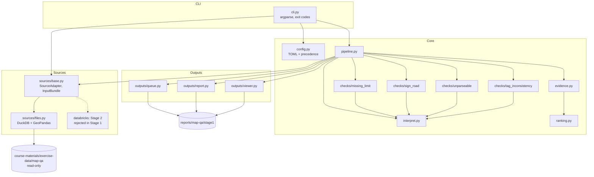
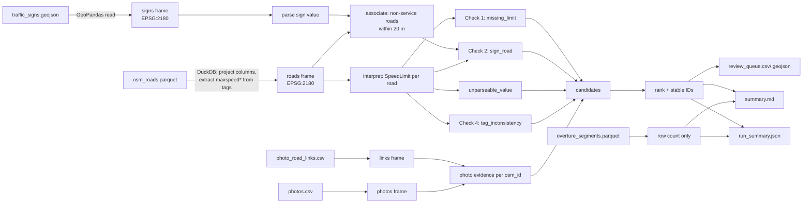
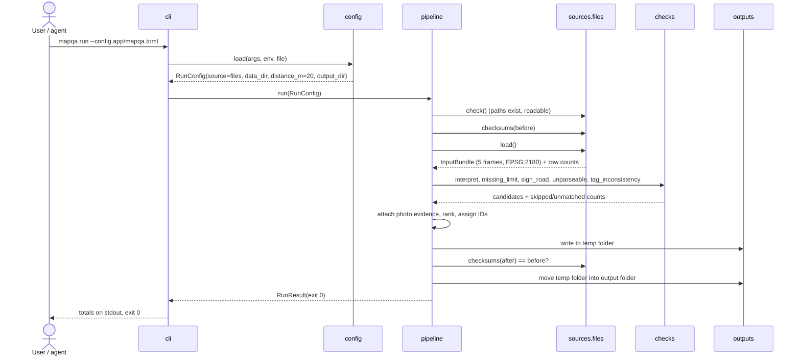
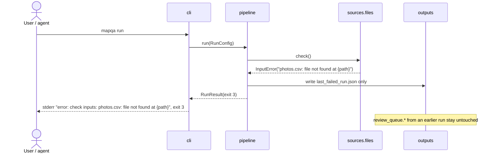
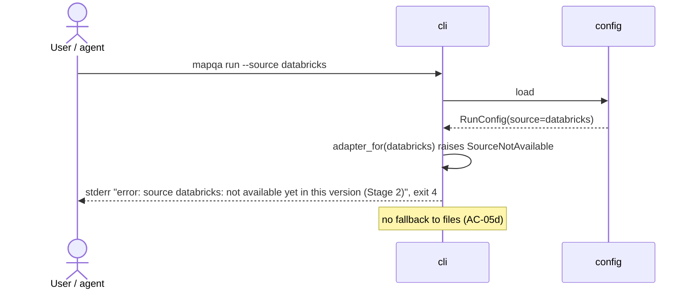
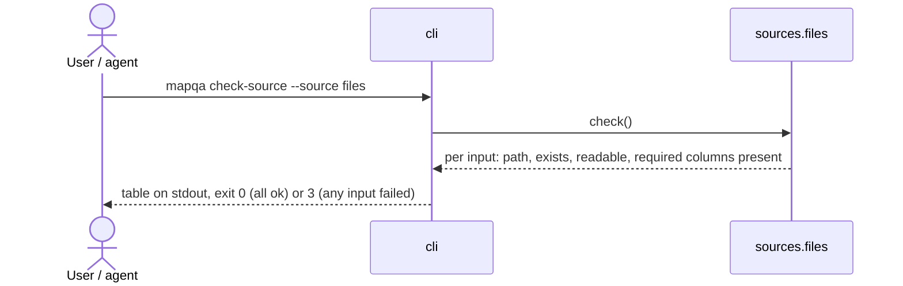

# ADR: Speed-Limit Conflict Finder (Kraków) — Main Architecture, Stage 1

**Date:** 2026-11-12
**Status:** Accepted (revised 2026-11-12 after the data profile)
**PRD:** [`docs/PRD.md`](../PRD.md)
**Scope decision:** [`docs/mvp-scope.md`](../mvp-scope.md)
**Data profile:** [`reports/map-qa/profile.md`](../../reports/map-qa/profile.md)

**Revision 2026-11-12:** fourth check `tag_inconsistency` (PRD AC-17a) and reason `stale_sign` (AC-17b) added; geometry read path and Databricks facts verified (ADR-001 §4.4–4.5); prerequisites updated (uv installed).

---

## 1. Overview

Stage 1 delivers a **command-line tool** (`mapqa`) that reads the pinned Kraków snapshot from local files, interprets OSM speed limits, runs the checks of ADR-002 §6 (`missing_limit`, `sign_road`, `unparseable_value`, `tag_inconsistency`) and writes a ranked review queue (CSV + GeoJSON), a Markdown summary report, a machine-readable JSON run summary and a **read-only static viewer** `viewer.html` (ADR-003). Analysts use the viewer, QGIS or a spreadsheet; other agents read the JSON summary.

This ADR set, together with the PRD and the MVP scope document, is the complete specification for the Stage 1 implementation. It covers:

| File | Area |
|---|---|
| `000-main-architecture.md` (this file) | Stack, repository layout, modules, data models, CLI and output contracts, cross-cutting decisions, diagrams, test strategy |
| [`001-data-sources-and-config.md`](001-data-sources-and-config.md) | Configuration file, source selection, the `files` source adapter, input validation, checksums |
| [`002-detection-rules.md`](002-detection-rules.md) | Speed-limit interpretation, sign-to-road association, check rules, reason codes, ranking, stable identifiers, photo evidence |

**In scope (Stage 1, from `mvp-scope.md` §2):** items 1–8 incl. 5a — CLI, source configuration (`files` only implemented), interpretation, Check 1 (missing limit), Check 2 (sign vs road, always `needs_review`, incl. `stale_sign`), unparseable-value check, Check 3 (tag inconsistency, `conflict`), evidence, ranking and stable IDs, outputs.

**Out of scope for Stage 1:** `databricks` and `public_api` sources (recognised and rejected), OSM vs Overture check, verdict recording (UI or files), model reading of signs (Phase 2), tertiary roads in "missing limit". The architecture keeps extension points for them (source adapter interface, stable candidate IDs) but implements none.

---

## 2. Technology Documentation References

Context7 was not reachable when this ADR was written (the configured MCP server returned "Invalid API key" on 2026-11-12). No Context7 IDs are recorded; official documentation links are used instead. An implementing agent with a working Context7 setup should resolve the IDs and add them to this table.

| Library | Version | Context7 ID or official docs | Used for |
|---|---|---|---|
| Python | 3.12 | https://docs.python.org/3.12/ (`argparse`, `tomllib`, `hashlib`, `json`, `csv`) | Runtime, CLI, config parsing, checksums |
| uv | latest installed | https://docs.astral.sh/uv/ (projects, `[project.scripts]`, `uv run`, `uv lock`) | Project, venv, lockfile, running the CLI |
| DuckDB (Python) | 1.5.6 (pinned in data README) | https://duckdb.org/docs/stable/clients/python/overview , https://duckdb.org/docs/stable/data/parquet/overview , https://duckdb.org/docs/stable/sql/functions/json | Reading GeoParquet/CSV, column projection, extracting tags from the JSON `tags` string |
| GeoPandas | 1.2.0 (pinned in data README) | https://geopandas.org/en/stable/docs.html (`GeoDataFrame`, `to_crs`, `sjoin`, `read_file`, `to_file`) | In-memory spatial model, reprojection, buffer join, GeoJSON output |
| Shapely | resolved by uv lock (GeoPandas dependency) | https://shapely.readthedocs.io/en/stable/ (`from_wkb`, `STRtree`) | WKB decoding, geometry predicates |
| pyproj | resolved by uv lock (GeoPandas dependency) | https://pyproj4.github.io/pyproj/stable/ | CRS transformation EPSG:4326 → EPSG:2180 |
| pyarrow | 23.0.1 (pinned in data README) | https://arrow.apache.org/docs/python/ | Parquet backend for DuckDB → pandas transfer |
| pyogrio | resolved by uv lock (GeoPandas I/O engine) | https://pyogrio.readthedocs.io/ | Reading `traffic_signs.geojson`, writing GeoJSON |
| pytest | resolved by uv lock | https://docs.pytest.org/en/stable/ (`tmp_path`, `parametrize`, markers) | Unit and integration tests |
| EPSG:2180 | — | https://epsg.io/2180 | Metric CRS for Poland (PUWG 1992) |
| OSM `maxspeed` | — | https://wiki.openstreetmap.org/wiki/Key:maxspeed , https://wiki.openstreetmap.org/wiki/Default_speed_limits#Poland | Interpretation rules, implicit Polish values |
| Mapillary traffic-sign classes | — | https://www.mapillary.com/developer/api-documentation/ | Format of `object_value` |

Before using any option or API, follow the lookup order in `AGENTS.md` (CLI `--help` → Context7 → official docs). The installed version wins over this table.

---

## 3. System Architecture

### Architecture pattern

Single-process **batch pipeline** behind a CLI, organised as a layered package with one pluggable boundary (the source adapter). No server, no database, no network access in Stage 1.

### Repository structure

```
app/
  pyproject.toml          uv project, requires-python ">=3.12,<3.13", [project.scripts] mapqa = "mapqa.cli:main"
  uv.lock                 committed lockfile
  .python-version         3.12
  mapqa.example.toml      documented example configuration (no secrets)
  src/mapqa/
    cli.py                argument parsing, exit codes, orchestration call
    config.py             load + merge configuration (ADR-001)
    sources/              source adapters (ADR-001)
      base.py             adapter interface + InputBundle
      files.py            local-files adapter (Stage 1)
    interpret.py          speed-limit interpretation (ADR-002)
    checks/
      missing_limit.py    Check 1
      sign_road.py        Check 2 incl. sign-to-road association
      unparseable.py      unparseable-value check
      tag_inconsistency.py  implicit source vs maxspeed
    evidence.py           photo evidence per road
    ranking.py            ordering + stable IDs
    outputs/
      queue.py            review_queue.csv + review_queue.geojson
      report.py           summary.md
      viewer.py           viewer.html (+ viewer_template.html), ADR-003
    pipeline.py           runs the stages in order, writes run_summary.json, returns RunResult
  tests/
    unit/
    integration/
    fixtures/             small slices of real rows + README listing their source IDs
reports/map-qa/stage1/    default output folder (git-ignored)
```

The tool is invoked from the repository root as `uv run --project app mapqa ...` or from `app/` as `uv run mapqa ...`. Paths in the configuration file are resolved relative to the configuration file's own folder; paths given on the command line are resolved relative to the current working directory.

### Technology stack

| Layer | Technology | Reason |
|---|---|---|
| Runtime | Python 3.12 managed by uv | Course stack; uv installs 3.12 independently of the system Python (3.14 on the VMs). |
| CLI | `argparse` (stdlib) | Zero dependencies, subcommands, full control over exit codes and `--help` text for agents. |
| Configuration | TOML via `tomllib` (stdlib) | No dependency, comments allowed, same format as `pyproject.toml`. |
| Reading inputs | DuckDB 1.5.6 | Fast columnar reads of GeoParquet/CSV, JSON tag extraction in SQL; the same SQL shape is reused against Databricks in Stage 2. |
| Spatial processing | GeoPandas 1.2.0 + Shapely + pyproj | Reprojection to EPSG:2180, buffer joins, deterministic in-memory logic that is easy to unit-test on tiny fixtures. |
| Outputs | `csv`/pandas (CSV), GeoPandas/pyogrio (GeoJSON), plain text (Markdown), `json` (run summary) | Opens directly in QGIS and spreadsheets; JSON is agent-readable. |
| Tests | pytest | Course stack; `tmp_path` isolates outputs. |
| AI/LLM | none in Stage 1 | PRD §11: no model in the MVP. |
| Persistence | files only | No verdicts in Stage 1; no database needed. |

---

## 4. Module Structure & Dependencies

Dependency direction is strictly downward in the list below; no module imports a module listed above it. `cli` is the only module that knows about exit codes and stdout formatting.

| Module | Responsibility | Depends on | Used by |
|---|---|---|---|
| `cli` | Parse arguments, call `config` and `pipeline`, map exceptions to exit codes, print totals | `config`, `pipeline`, `sources` (for `check-source`) | entry point |
| `pipeline` | Run stages in order: load → validate → interpret → checks → evidence → rank → write; return `RunResult` | all modules below | `cli` |
| `config` | Load TOML, apply precedence, validate values, produce `RunConfig` | stdlib only | `cli`, `pipeline`, `sources` |
| `sources.base` | `SourceAdapter` interface, `InputBundle`, source errors | `config` | `sources.files`, `pipeline` |
| `sources.files` | Read the five local inputs, normalise columns, compute checksums | `sources.base`, DuckDB, GeoPandas | `pipeline`, `cli` |
| `interpret` | Pure functions: raw OSM tags → `SpeedLimit` | stdlib only | `checks.*`, `pipeline` |
| `checks.missing_limit` | Check 1 | `interpret`, models | `pipeline` |
| `checks.sign_road` | Sign parsing, association within distance, Check 2 | `interpret`, GeoPandas | `pipeline` |
| `checks.unparseable` | Unparseable-value candidates | `interpret` | `pipeline` |
| `checks.tag_inconsistency` | `source:maxspeed` / `maxspeed:type` vs `maxspeed` (ADR-002 §6.4) | `interpret` | `pipeline` |
| `evidence` | Attach photo IDs and counts per OSM way | models | `pipeline` |
| `ranking` | Sort key and stable candidate IDs | models | `pipeline` |
| `outputs.*` | Serialise candidates and counts; atomic write | models, GeoPandas | `pipeline` |

Domain models (`Candidate`, `SpeedLimit`, `RunCounts`, …) live in `mapqa/models.py` and depend on nothing but the stdlib; every module may import them.

---

## 5. Data Models

All models are immutable value objects (frozen dataclasses). Geometries are stored in EPSG:2180 during processing and converted to EPSG:4326 only when writing GeoJSON.

### Input tables (normalised by the source adapter, see ADR-001 §4)

| Model | Key fields | Notes |
|---|---|---|
| `OsmRoad` table | `osm_id` (int), `osm_version` (int), `osm_timestamp` (str ISO), `highway` (str), `maxspeed` (str or null), `maxspeed_forward`, `maxspeed_backward`, `maxspeed_conditional`, `maxspeed_variable`, `source_maxspeed`, `maxspeed_type` (str or null, extracted from `tags`), `oneway`, `bridge`, `tunnel`, `layer` (str or null), `name` (str or null), `tags` (raw JSON string, unchanged), `geometry` (LineString, EPSG:2180) | ~99,768 rows |
| `TrafficSign` table | `sign_id` (str, Mapillary map-feature id), `object_value` (str), `first_seen_at`, `last_seen_at` (str ISO), `image_ids` (list of str), `source_url` (str), `geometry` (Point, EPSG:2180) | 1,730 rows |
| `Photo` table | all columns of `photos.csv`; `heading` kept as nullable float (empty ≠ 0) | 561 rows; never used for direction (AC-18) |
| `PhotoRoadLink` table | all columns of `photo_road_links.csv` | 561 rows, one per photo: 558 with an OSM way (557 by source reference, 1 `spatial_fallback`), 3 without; only 230 distinct OSM ways have any photo |
| `OvertureSegment` table | `id`, `class`, `sources`, `speed_limits`, `geometry` | Read and counted only (AC-04, AC-05f); not used by any Stage 1 check |

### Derived models

| Model | Fields | Relationships |
|---|---|---|
| `SpeedLimit` | `kind` (`numeric` / `directional` / `missing` / `unparseable`), `value_kmh` (int or null), `forward_kmh`, `backward_kmh` (int or null), `implicit` (bool), `converted_from_mph` (bool), `conditional` (bool), `variable` (bool), `raw` (dict of the original `maxspeed*` tag values) | One per OSM road; computed by `interpret` (ADR-002 §3) |
| `SignReading` | `sign_id`, `value_kmh` (int or null), `parse_status` (`ok` / `unparseable`) | One per sign (ADR-002 §4) |
| `Candidate` | `candidate_id` (str, stable), `type` (`missing_limit` / `sign_road` / `unparseable_value` / `tag_inconsistency`), `state` (`conflict` / `needs_review`), `reason_code` (str), `explanation` (str, one English sentence), `road_class` (str), `rank` (int, 1-based), `osm_ids` (list of int), `sign_id` (str or null), `osm_value_raw` (str or null), `osm_value_kmh` (int or null), `osm_forward_kmh`, `osm_backward_kmh` (int or null), `sign_value_kmh` (int or null), `diff_kmh` (int or null, absolute), `distance_m` (float or null, 1 decimal), `sign_first_seen_at`, `sign_last_seen_at` (str or null), `photo_count` (int), `photo_ids` (list of str, nearest first), `osm_version` (int), `osm_timestamp` (str), `geometry` | Produced by checks; `rank` and `candidate_id` set by `ranking` |
| `RunCounts` | rows read per dataset; candidates per `type × state`; candidates per `road_class`; skipped records per reason; unmatched signs | Feeds report and run summary (AC-04) |
| `RunResult` | `config` (resolved, no secrets), `source` (kind, location, read time), `input_checksums` (path → SHA-256, before and after), `counts`, `candidates`, `output_paths`, `exit_code` | Returned by `pipeline` |

No verdict model exists in Stage 1. Output schemas contain no verdict columns; adding them later must not change existing column names or candidate IDs.

---

## 6. API / Interface Contracts

### 6.1 CLI

`mapqa --help` lists every subcommand, every option, the three source names and the exit codes.

| Command | Purpose | Options |
|---|---|---|
| `mapqa run` | Full pipeline | `--config PATH`, `--source {files,databricks,public_api}`, `--data-dir PATH`, `--output-dir PATH`, `--distance-m FLOAT` |
| `mapqa check-source` | Verify that the selected source is usable without running checks (ADR-001 §5) | `--config PATH`, `--source …`, `--data-dir PATH` |
| `mapqa view` | Regenerate `viewer.html` from the last run and open it (ADR-003 §5) | `--output-dir PATH`, `--no-open` |

Command-line options override the configuration (precedence in ADR-001 §3).

**Exit codes** (identical for both commands):

| Code | Meaning |
|---|---|
| 0 | Success |
| 1 | Unexpected internal error (bug); traceback printed to stderr |
| 2 | Usage or configuration error (bad option, invalid TOML, invalid value) — argparse's own usage errors also return 2 |
| 3 | Input error: a required input is missing, unreadable or lacks required columns (AC-02) |
| 4 | Source error: source not available yet (`databricks`, `public_api` in Stage 1) or unreachable (AC-05d) |

**stdout on success:** a short block with source, location, rows read per dataset, candidates per type × state, skipped per reason, and the output folder. **stderr on failure:** one line `error: <step>: <message naming the input or source>`. No credential value is ever printed.

### 6.2 Output files

Written to the output folder (default `reports/map-qa/stage1/`). All text files are UTF-8, LF line endings. Outputs are written to a temporary sibling folder and moved into place only after every file has been written successfully; on any error nothing in the output folder is replaced (AC-02).

| File | Content | Contract |
|---|---|---|
| `review_queue.csv` | One row per candidate in rank order | Columns, in order: `rank, candidate_id, type, state, reason_code, explanation, road_class, osm_ids, sign_id, osm_value_raw, osm_value_kmh, osm_forward_kmh, osm_backward_kmh, sign_value_kmh, diff_kmh, distance_m, sign_first_seen_at, sign_last_seen_at, photo_count, photo_ids, osm_version, osm_timestamp, lon, lat`. List fields joined with `;`. Empty string for null. `lon`/`lat` = representative point (sign position, or the road's midpoint on the line) in EPSG:4326, 6 decimals. |
| `review_queue.geojson` | Same rows as features | EPSG:4326 (RFC 7946). Geometry: sign `Point` for `sign_road`, road `LineString` for `missing_limit`, `unparseable_value` and `tag_inconsistency`. Properties = CSV columns except `lon`/`lat`. Coordinates rounded to 7 decimals. QGIS loads it as two sub-layers by geometry type. |
| `viewer.html` | Analyst | Read-only map + table + candidate detail with embedded data (ADR-003). |
| `viewer_context.json` | `mapqa view` | Road geometries for sign candidates and photo metadata from the run's own source, so `view` reads only the output folder (ADR-004 §6). |
| `summary.md` | Team-lead report | Sections: snapshot identification (OSM extract date, Overture release, from `sources.json`), source and read time, rows read, table type × state, table by road class, skipped and unmatched with reasons, distance limit used, the implicit-value mapping table, attribution and licences (AC-27) copied from `ATTRIBUTION.md` headings. Every count equals the matching rows in `review_queue.csv` (AC-26). Wording uses "candidate", never "error". |
| `run_summary.json` | Agent-readable summary | Keys: `tool_version`, `command`, `exit_code`, `source` {`kind`, `location`, `read_at`}, `config` {resolved values, no secrets}, `inputs` {name → {`path`, `rows`, `sha256_before`, `sha256_after`}}, `counts` {`by_type_state`, `by_road_class`, `skipped`, `unmatched`}, `outputs` {name → relative path}. Written also on exit codes 3 and 4 into the output folder's `last_failed_run.json` (the queue is not written in that case). |

**Determinism (AC-03):** `review_queue.csv` and `review_queue.geojson` contain no timestamps of the run and are byte-identical across runs on the same inputs and configuration. `read_at`, `tool_version` and the run time appear only in `summary.md` and `run_summary.json`.

---

## 7. Environment Variables

| Variable | Purpose | Required | Example value |
|---|---|---|---|
| `MAPQA_DATA_SOURCE` | Source selection when `--source` is not given | No | `files` |
| `MAPQA_CONFIG` | Path to the TOML configuration when `--config` is not given | No | `app/mapqa.toml` |
| `DATABRICKS_TOKEN` | Stage 2 only. Not read in Stage 1; `check-source --source databricks` reports "not available yet" without inspecting it | No | set by the user in the terminal, never in a file |
| `DATABRICKS_HOST`, `DATABRICKS_SQL_WAREHOUSE_ID` | Stage 2 only, fallback for `source.databricks.host` / `warehouse_id` (ADR-001 §4.5). Not read in Stage 1 | No | `https://<workspace>` / `97c455ee6fb1fcb9` |

No other variables are read. `.env` files are not loaded by the tool.

---

## 8. Technical Decisions

### D1. Hybrid read/process engine: DuckDB for reading, GeoPandas for logic
**Status:** Accepted
**Date:** 2026-11-12
**Context:** ~100k OSM roads with a JSON `tags` string must be read and filtered, then joined spatially to 1,730 signs in metres. Stage 2 must produce an identical queue from Databricks tables (AC-05b).
**Decision:** The source adapter uses DuckDB to read and project columns and to extract the `maxspeed*`, `source:maxspeed` and `maxspeed:type` keys from `tags`; it returns pandas/GeoPandas frames with a fixed schema. All rule logic runs on those frames in GeoPandas/Shapely. A Databricks adapter in Stage 2 only has to return the same frames.
**Rejected alternatives:**
- GeoPandas only: JSON tag extraction row-by-row in Python is slower and the read path would share nothing with the Stage 2 SQL.
- DuckDB spatial only: rule logic in SQL is harder to unit-test on six-row fixtures.

*Verified 2026-11-12:* DuckDB 1.5.6 returns GeoParquet geometry as a native `GEOMETRY` type, so the adapter loads the `spatial` extension and selects `ST_AsWKB(geometry)` (ADR-001 §4.4). The extension is installed once per user profile.
**Consequences:**
- (+) Rules are testable without any I/O; the source boundary is the parity point for Stage 2.
- (-) Two data libraries; geometry crosses the boundary as WKB and must be decoded with Shapely.
**Review trigger:** A full run exceeds 3 minutes on the training VM, or Stage 2 parity fails because of a type difference between adapters.

### D2. Metric CRS EPSG:2180 for all distances
**Status:** Accepted
**Date:** 2026-11-12
**Context:** AC-05 forbids distances in degrees. The data README and the MVP profiling use EPSG:2180.
**Decision:** Every geometry is reprojected to EPSG:2180 immediately after reading. All buffers and distances use it. Outputs are reprojected to EPSG:4326.
**Rejected alternatives:**
- EPSG:2177 (PUWG 2000 zone 7): slightly more accurate for Kraków, but the profiling numbers in `mvp-scope.md` would no longer be reproducible.
- Geodesic distances in EPSG:4326: slower and inconsistent with the profiling.
**Consequences:**
- (+) Numbers match the MVP scope profiling.
- (-) Scale distortion of a few centimetres per 20 m in Kraków, irrelevant at this threshold.
**Review trigger:** Supporting areas outside Poland.

### D3. CLI with argparse and fixed exit codes
**Status:** Accepted
**Date:** 2026-11-12
**Context:** The tool must be self-describing for agents (`mvp-scope.md` §3) and distinguish success, input errors and source errors.
**Decision:** `argparse` with subcommands `run` and `check-source`, exit codes 0–4 as in §6.1.
**Rejected alternatives:**
- Typer: nicer help, but adds Typer/Click/Rich and hides exit-code handling.
- Click: mature, but more boilerplate for no gain at two subcommands.
**Consequences:**
- (+) No dependency; exit codes are explicit and tested.
- (-) Help text and validation are written by hand.
**Review trigger:** More than five subcommands, or Stage 3 needs interactive confirmation prompts.

### D4. Stage 1 outputs are files; no UI, no verdict storage
**Status:** Amended 2026-11-12 by [ADR-003](003-viewer.md): a read-only static `viewer.html` is added to the outputs; verdict storage remains out of Stage 1.
**Date:** 2026-11-12
**Context:** PRD §9 leaves the delivery form to the ADR; `mvp-scope.md` §2 defers UI and verdicts.
**Decision:** CSV + GeoJSON + Markdown + JSON as in §6.2. QGIS is the review tool for Stage 1.
**Rejected alternatives:**
- Static HTML report: needs a separate verdict mechanism (AC-23) before the queue content is stable.
- Local dashboard: highest effort; deferred until after the precision sample.
**Consequences:**
- (+) Minimal surface; outputs are diffable and agent-readable.
- (-) AC-23–AC-25 (verdicts, review status) are not met in Stage 1. *(Amended by ADR-003: AC-28 map attribution and offline photo thumbnails are provided by `viewer.html`.)*
**Review trigger:** The manual precision sample (`mvp-scope.md` §4) is complete, or analysts need verdicts recorded.

### D5. Atomic output writing
**Status:** Accepted
**Date:** 2026-11-12
**Context:** AC-02: no queue may be written when an input is missing; a crashed run must not leave a half-written queue that looks complete.
**Decision:** Write all outputs into a temporary folder next to the output folder, then replace the output folder's files in one step. On failure, delete the temporary folder and write only `last_failed_run.json`.
**Rejected alternatives:**
- Write files in place: a crash leaves a mixed old/new set.
**Consequences:**
- (+) The output folder always contains one consistent run.
- (-) Briefly needs twice the output disk space (a few MB).
**Review trigger:** Outputs grow beyond ~100 MB.

### D6. Deterministic outputs
**Status:** Accepted
**Date:** 2026-11-12
**Context:** AC-03 requires identical queues on identical inputs.
**Decision:** All frames are sorted by explicit keys before every join and before writing; no set/dict iteration order reaches the output; floats are rounded at write time (distances 0.1 m, coordinates 6–7 decimals); no run timestamp in queue files.
**Rejected alternatives:**
- Compare outputs semantically in tests only: hides non-determinism from users diffing files.
**Consequences:**
- (+) Byte-level diff of two runs is a valid regression check.
- (-) Explicit sorting everywhere.
**Review trigger:** None expected.

### D7. Overture is read but unused in Stage 1
**Status:** Accepted
**Date:** 2026-11-12
**Context:** The OSM vs Overture check is deferred (`mvp-scope.md` §1.2), but AC-04/AC-05f require row counts per dataset and Stage 2 parity covers all five datasets.
**Decision:** The adapter reads `overture_segments.parquet` (id, class, geometry presence only), validates it and counts rows. No check uses it.
**Rejected alternatives:**
- Skip Overture entirely: the run summary would not describe the full snapshot and Stage 2 parity would have a gap.
**Consequences:**
- (+) Snapshot description complete; check can be added later without touching the adapter.
- (-) A few hundred ms extra read time.
**Review trigger:** The OSM vs Overture check is brought back.

---

## 9. Diagrams

### 9.1 Architecture / Component Diagram



### 9.2 Data Flow Diagram



### 9.3 Sequence Diagrams

#### Full run on local files (happy path)



#### Missing or unreadable input (error path)



#### Source not available in Stage 1



#### check-source



---

## 10. Testing Strategy

### Philosophy

TDD per `AGENTS.md`: for every rule, write the failing test first from the PRD/ADR text, run it, see it fail for the expected reason, then implement. Unit tests use small fixtures cut from real rows (decision D-T1 below), so the schema in tests is the real schema. The integration test runs the real CLI on the real snapshot. `mvp-scope.md` §4 caps unit cases at **six per stage**; each case below may be parametrised over several rows.

**D-T1 (Accepted, 2026-11-12):** fixtures are small GeoJSON/Parquet slices extracted from `course-materials/exercise-data/map-qa/` into `app/tests/fixtures/`, each listed in `app/tests/fixtures/README.md` with source file, source IDs and the reason the row was chosen. Synthetic rows are allowed only for cases absent from the snapshot (e.g. `mph`, free-text `maxspeed`) and are marked `synthetic` in that README. Rejected: synthetic-only (drifts from the real schema) and full data in unit tests (slow, brittle).

### Test layers

| Layer | Type | Scope | Tools |
|---|---|---|---|
| Unit | Pure functions and checks on fixture frames; no file I/O except fixtures | `interpret`, `checks.*`, `ranking`, `evidence`, `config` | pytest, parametrize |
| Integration | Real CLI (`subprocess` running `mapqa`) on the real snapshot; outputs into `tmp_path` | whole pipeline, exit codes, determinism, input immutability | pytest, marker `integration` |
| E2E | Real CLI run (integration suite) + browser QA of `viewer.html` (ADR-003 §8) | real stack | pytest, Playwright |
| Manual QA | Open `review_queue.geojson` in QGIS, read `summary.md`, inspect 5 candidates | AGENTS.md Manual QA for CLI | QGIS, terminal |

Integration tests are marked `integration` and run with `uv run pytest -m integration`; the default `uv run pytest` runs everything.

### Key test scenarios

Unit (six cases, details and fixture rows in ADR-002 §9):

1. **Interpretation** — numeric, mph, implicit `PL:*`, directional, conditional, variable, unparseable, missing → correct `SpeedLimit`; raw values preserved byte-for-byte.
2. **Directional comparison** — sign equals `maxspeed:forward` or `:backward` → no candidate; equals neither → `needs_review` / `direction_unknown`.
3. **Sign association** — exactly one non-service road within 20 m vs two or more; boundary at exactly 20.0 m counted as inside; `service` roads ignored; 0 roads → unmatched count.
4. **Bridge or tunnel / conditional / variable** on the single associated road → `needs_review` with the specific reason, precedence as in ADR-002 §6.
5. **Road-level checks** — missing limit: main classes and their links without any `maxspeed*` → `conflict`, `tertiary` and roads with directional tags → none; tag inconsistency: `PL:urban` + 70 → `conflict`, `PL:rural` + 100 → none.
6. **Ranking and stable IDs** — order by class, then `diff_kmh` desc with nulls last, then ID; same input in shuffled row order → same IDs and ranks.

`config` precedence and exit-code mapping are covered by parametrised cases inside the integration suite (they need the CLI process anyway).

Integration:

| Scenario | Input | Expected |
|---|---|---|
| Full run | real snapshot, default config | exit 0; six output files (incl. `viewer.html`, `viewer_context.json`); counts in `run_summary.json` equal row counts in `review_queue.csv` per type × state |
| Inputs unchanged | same | SHA-256 of all five inputs identical before and after (AC-01) |
| Determinism | two runs into two `tmp_path` folders | `review_queue.csv` and `.geojson` byte-identical (AC-03) |
| Missing input | data dir copy in `tmp_path` without `photos.csv` | exit 3; stderr names `photos.csv`; no `review_queue.csv` written (AC-02) |
| Unavailable source | `--source databricks` | exit 4; stderr names the source; no outputs except `last_failed_run.json` |
| Precedence | `--source files` with `MAPQA_DATA_SOURCE=databricks` | exit 0 (CLI wins) |
| Order of magnitude | real snapshot | ranges of ADR-002 TAC-002-04: `missing_limit` 250–330 (measured 290), `tag_inconsistency` 140–180 (161), single-road signs 380–460 (420), `stale_sign` 170–210 (191) |

### Technical acceptance criteria

- **TAC-01** `uv run mapqa --help` and `uv run mapqa run --help` exit 0 and list `files`, `databricks`, `public_api` and exit codes 0–4.
- **TAC-02** A full run on the pinned snapshot completes in under 3 minutes on the training VM and exits 0.
- **TAC-03** Two runs produce byte-identical `review_queue.csv` and `review_queue.geojson`.
- **TAC-04** Input SHA-256 checksums before and after a run are identical and are recorded in `run_summary.json`.
- **TAC-05** Every count in `summary.md` and `run_summary.json` equals the number of matching rows in `review_queue.csv`.
- **TAC-06** No distance is computed on geometries whose CRS is not EPSG:2180 (asserted in `checks.sign_road` before the join).
- **TAC-07** No `sign_road` candidate has state `conflict` in Stage 1.
- **TAC-08** `review_queue.geojson` opens in QGIS without errors and shows features in Kraków (manual check, screenshot in task summary).
- **TAC-09** `uv run pytest` passes with no warnings introduced by the project; the Stage 1 unit suite consists of the six cases in ADR-002 §9 (each may be parametrised).

---

## 11. Prerequisites and Open Questions

**Prerequisites on the training VM (updated 2026-11-12):**
- `uv` 0.13.7 installed via winget; it manages Python 3.12.16 for the project. The system Python 3.14 has no DuckDB/GeoPandas — the tool must never rely on it.
- DuckDB `spatial` extension installed in the user profile (by the profile run).
- Databricks CLI 1.26.0 installed; read access to `workspace.map_qa` verified (Stage 2 only).
- Context7 MCP still returns "Invalid API key"; fix the user-level configuration (`CONTEXT7_API_KEY` in the environment, never in the repo) to add Context7 IDs to §2.

**Open questions (do not block Stage 1):**
1. Should `track` roads be excluded from sign association like `service`? Stage 1 excludes only `service`, matching the profiling.
2. ~~PRD open question 3 (stale sign)~~ — resolved: reason `stale_sign` (PRD AC-17b, ADR-002 §6.2).
3. PRD open question 4 (shared verdict storage) is deferred with verdicts.
