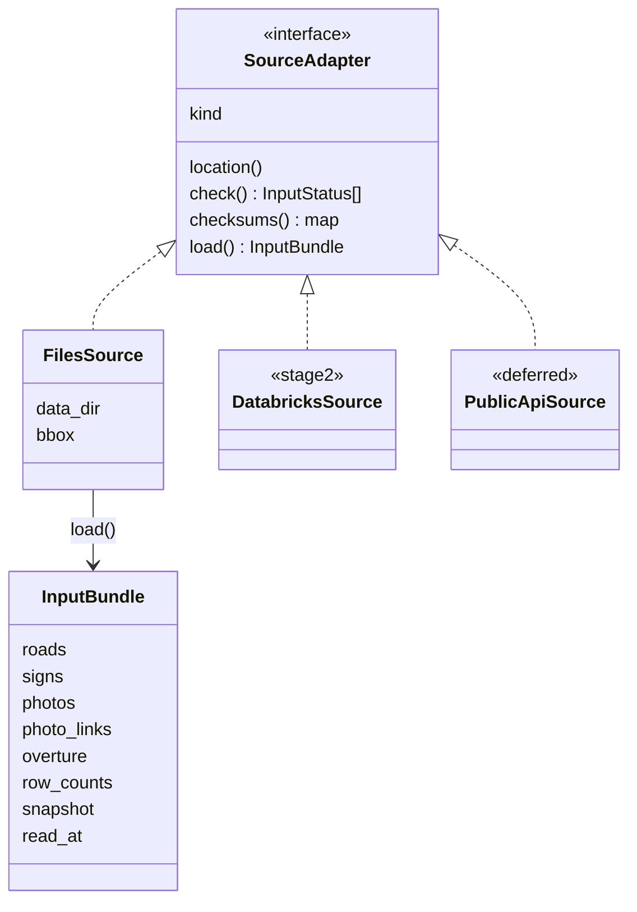
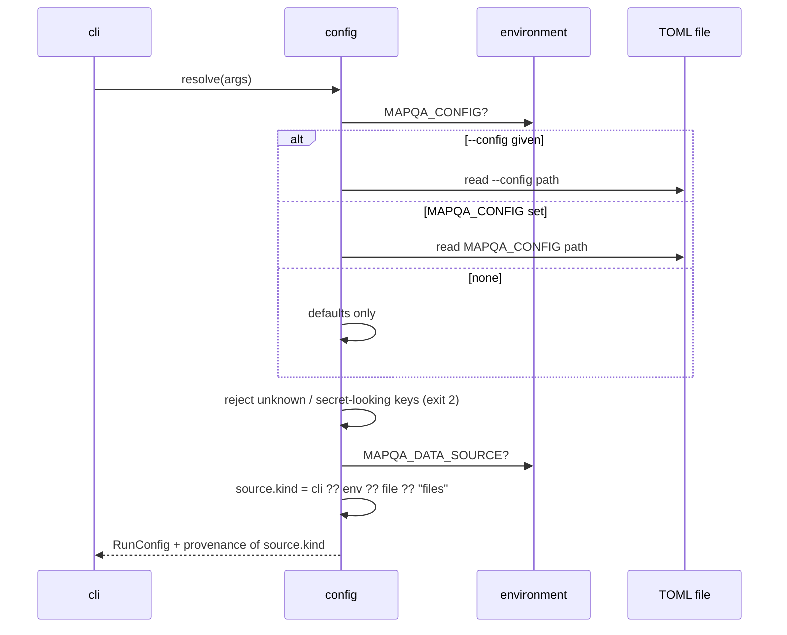
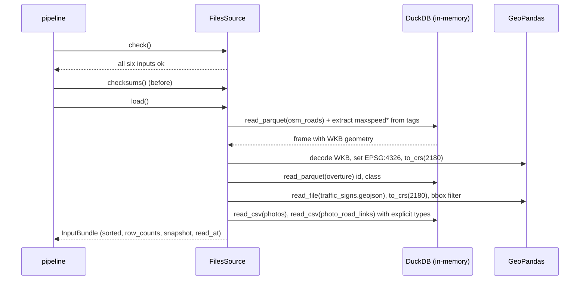

# ADR-001: Data Sources and Configuration

**Date:** 2026-11-12
**Status:** Accepted
**Relates to:** [`docs/ADR/000-main-architecture.md`](000-main-architecture.md), PRD AC-01, AC-02, AC-04, AC-05, AC-05a–AC-05f, `mvp-scope.md` §3

---

## 1. Scope

Covers: the configuration file and its precedence rules, source selection, the source adapter interface, the Stage 1 `files` adapter (reading, column normalisation, reprojection, validation, checksums) and the `check-source` command.

Does not cover: the `databricks` adapter (Stage 2) and the `public_api` adapter (deferred) beyond their rejection in Stage 1; any rule logic (ADR-002); output formats (ADR-000 §6.2).

---

## 2. Technology Documentation References

| Library | Context7 ID or official docs | Used for |
|---|---|---|
| `tomllib` | https://docs.python.org/3.12/library/tomllib.html | Reading the TOML configuration |
| `argparse` | https://docs.python.org/3.12/library/argparse.html | `--config`, `--source`, `--data-dir` options |
| `hashlib` | https://docs.python.org/3.12/library/hashlib.html | SHA-256 checksums of inputs |
| DuckDB Python 1.5.6 | https://duckdb.org/docs/stable/clients/python/overview | Connection, query → pandas/Arrow |
| DuckDB Parquet | https://duckdb.org/docs/stable/data/parquet/overview | `read_parquet` with column projection |
| DuckDB CSV | https://duckdb.org/docs/stable/data/csv/overview | `read_csv` with explicit column types |
| DuckDB JSON functions | https://duckdb.org/docs/stable/sql/functions/json | Extracting `maxspeed:*` keys from the `tags` string |
| GeoPandas 1.2.0 I/O | https://geopandas.org/en/stable/docs/user_guide/io.html | `read_file` for the signs GeoJSON, `GeoSeries.from_wkb`, `to_crs` |

No Context7 IDs: Context7 MCP was unavailable (see ADR-000 §2).

---

## 3. Configuration

### 3.1 File format and location

A single TOML file. Its path is taken from, in order: `--config PATH`, environment variable `MAPQA_CONFIG`, otherwise no file (built-in defaults only). A path given explicitly that does not exist is a configuration error (exit 2). Relative paths inside the file are resolved against the file's folder.

`app/mapqa.example.toml` is committed and documents every key with a comment. A user copies it to `app/mapqa.toml` (git-ignored) to customise.

### 3.2 Keys

| Key | Type | Default | Validation | Notes |
|---|---|---|---|---|
| `source.kind` | string | `files` | one of `files`, `databricks`, `public_api` | Selection precedence below |
| `source.files.data_dir` | path | `course-materials/exercise-data/map-qa` relative to the repository root (the folder containing `app/`) | must exist for `files` | |
| `source.databricks.host` | string | none | not validated in Stage 1 | Stage 2; secret-free |
| `source.databricks.warehouse_id` | string | none | not validated in Stage 1 | Stage 2 |
| `source.databricks.schema` | string | `workspace.map_qa` | not validated in Stage 1 | Stage 2 |
| `area.bbox` | array of 4 floats `[min_lon, min_lat, max_lon, max_lat]` | `[19.80, 49.95, 20.15, 50.15]` | min < max, within −180..180 / −90..90 | Signs outside the bbox are skipped with reason `outside_area`; roads are kept whole (PRD §8) |
| `checks.sign_road_distance_m` | float | `20.0` | 1.0 ≤ value ≤ 100.0 | Shown in `summary.md` and `run_summary.json` |
| `checks.main_road_classes` | array of strings | `["motorway","motorway_link","trunk","trunk_link","primary","primary_link","secondary","secondary_link"]` | non-empty, values are OSM `highway` values | Check 1 scope; `tertiary` can be added later (PRD open question 5) |
| `checks.association_excluded_classes` | array of strings | `["service"]` | OSM `highway` values | Roads ignored when associating signs |
| `output.dir` | path | `reports/map-qa/stage1` relative to the repository root | parent folder must be writable | Must not be inside `data_dir` (checked; exit 2) |

Unknown keys are a configuration error (exit 2) naming the key, so typos do not silently fall back to defaults.

**Secrets are never configuration keys.** If the TOML contains any key named `token`, `password`, `secret` or ending in `_token`, the run exits 2 with "secrets must be set in the environment, not in the config file"; the value is not echoed.

### 3.3 Precedence

For every setting: command-line option → environment variable (only `MAPQA_DATA_SOURCE` for `source.kind`) → configuration file → built-in default. The resolved configuration (without secrets) is written to `run_summary.json` under `config`, including which layer supplied `source.kind` (`cli`, `env`, `file`, `default`).

---

## 4. Source Adapters

### 4.1 Interface

`SourceAdapter` (in `sources/base.py`) exposes:

| Operation | Input | Output | Errors |
|---|---|---|---|
| `kind` | — | `files` / `databricks` / `public_api` | — |
| `location()` | — | human-readable location (folder path, schema, endpoints) | — |
| `check()` | — | list of `InputStatus` (name, location, exists, readable, missing columns) | `SourceUnavailable` |
| `checksums()` | — | mapping input name → SHA-256 hex (files only; other adapters return an empty mapping) | `InputError` |
| `load()` | — | `InputBundle` | `InputError`, `SourceUnavailable` |

`adapter_for(config)` returns a `FilesSource` for `files` and raises `SourceNotAvailable("<kind>: not available yet in this version (Stage 2)")` for `databricks` and `public_api`. The CLI maps `SourceNotAvailable` and `SourceUnavailable` to exit 4 and `InputError` to exit 3. There is no fallback to another adapter (AC-05d).

### 4.2 InputBundle

| Field | Content | CRS |
|---|---|---|
| `roads` | GeoDataFrame, schema `OsmRoad` (ADR-000 §5), sorted by `osm_id` | EPSG:2180 |
| `signs` | GeoDataFrame, schema `TrafficSign`, sorted by `sign_id` | EPSG:2180 |
| `photos` | DataFrame of `photos.csv`, sorted by `photo_id` | — (lon/lat kept as columns) |
| `photo_links` | DataFrame of `photo_road_links.csv`, sorted by `photo_id`, `osm_way_id` | — |
| `overture` | DataFrame with `id`, `class` only, sorted by `id` | — |
| `row_counts` | rows read per dataset before any filtering | — |
| `snapshot` | from `sources.json`: OSM `extract_date`, Overture `release`, `created_at`, bbox | — |
| `read_at` | UTC timestamp when reading started (ISO 8601) | — |

This bundle is the Stage 2 parity boundary: a Databricks adapter must return the same column names, dtypes and sort orders.

### 4.3 `files` adapter — required inputs

| Name | File (in `data_dir`) | Required columns / properties | Read with |
|---|---|---|---|
| `osm_roads` | `osm_roads.parquet` | `osm_id`, `osm_version`, `osm_timestamp`, `highway`, `maxspeed`, `oneway`, `bridge`, `tunnel`, `layer`, `name`, `tags`, `geometry` | DuckDB |
| `overture_segments` | `overture_segments.parquet` | `id`, `class`, `geometry` | DuckDB |
| `traffic_signs` | `traffic_signs.geojson` | properties `id`, `object_value`, `first_seen_at`, `last_seen_at`, `image_ids`, `source_url`; Point geometry | GeoPandas |
| `photos` | `photos.csv` | `photo_id`, `longitude`, `latitude`, `heading`, `captured_at`, `author`, `license`, `source` | DuckDB |
| `photo_road_links` | `photo_road_links.csv` | `photo_id`, `osm_way_id`, `distance_m`, `candidate_flags` | DuckDB |
| `snapshot` | `sources.json` | `osm.extract_date`, `overture.release`, `created_at`, `bbox_wgs84` | `json` |

All six are required. Any missing file, unreadable file or missing column → `InputError` naming the file and, for columns, the missing column names (AC-02).

### 4.4 Reading rules

- **OSM tags:** DuckDB extracts the string values of `maxspeed:forward`, `maxspeed:backward`, `maxspeed:conditional`, `maxspeed:variable`, `source:maxspeed` and `maxspeed:type` from the JSON `tags` column into the columns `maxspeed_forward`, `maxspeed_backward`, `maxspeed_conditional`, `maxspeed_variable`, `source_maxspeed`, `maxspeed_type`. The original `tags` string is passed through unchanged. Absent keys become null, never an empty string.
- **Geometry:** read as WKB from the GeoParquet `geometry` column and decoded with Shapely; source CRS EPSG:4326 for OSM (per `sources.json`), OGC:CRS84 for Overture (same axis order). If the installed DuckDB returns a native GEOMETRY type instead of WKB bytes, the adapter must convert explicitly; the implementing agent verifies which applies with the installed version before writing the adapter.
- **CSV typing:** columns are read with explicit types; `heading` and `distance_m` as nullable floats, IDs as strings except `osm_way_id` (BIGINT). An empty `heading` stays null (data README: `0.0` is north, not missing).
- **Reprojection:** roads and signs to EPSG:2180 immediately after decoding. Photos are not reprojected (their links are precomputed).
- **Area filter:** signs whose point lies outside `area.bbox` (inclusive edges) are dropped and counted as skipped `outside_area`. No other dataset is filtered by area.
- **Read-only:** files are opened read-only; DuckDB uses an in-memory database (no file created next to inputs); the adapter never writes inside `data_dir`.

### 4.5 Checksums (AC-01)

`checksums()` computes SHA-256 over the raw bytes of the six inputs, streaming in 1 MiB chunks. The pipeline calls it before `load()` and again after writing outputs. A mismatch is a bug: the run exits 1 with "input changed during run: <name>" and outputs stay in the temporary folder (not promoted).

---

## 5. `check-source` command

Runs `adapter_for(config)` and `check()` only. Prints one line per input: name, location, `ok` or the failure reason. Exit 0 when all inputs pass, 3 when any input fails, 4 when the source is not available. Prints no data values and no credentials. For `databricks` / `public_api` in Stage 1 it prints the "not available yet" message and exits 4 without reading any environment variable.

---

## 6. Technical Decisions

### TOML configuration with strict keys
**Status:** Accepted
**Date:** 2026-11-12
**Context:** Users and agents point the tool at a source without changing code (`mvp-scope.md` §3); silent fallbacks on typos would violate "no silent fallback".
**Decision:** TOML read with `tomllib`; unknown keys and secret-looking keys are errors.
**Rejected alternatives:**
- YAML: extra dependency (PyYAML) and implicit typing pitfalls (`no` → false).
- JSON: no comments, harder for humans to maintain.
**Consequences:**
- (+) No dependency; typos fail loudly.
- (-) Adding a key always needs a code change in the validator.
**Review trigger:** Configuration needs includes/profiles per environment.

### Six required inputs, including `sources.json` and Overture
**Status:** Accepted
**Date:** 2026-11-12
**Context:** AC-27 needs snapshot identification; AC-04/AC-05f need row counts for every dataset; Stage 2 parity covers all five tables.
**Decision:** All six files are required even though Stage 1 checks use only four.
**Rejected alternatives:**
- Optional Overture/photos: a run on an incomplete snapshot would look complete.
**Consequences:**
- (+) One rule: incomplete snapshot → exit 3.
- (-) A user cannot run Check 1 alone on a partial folder.
**Review trigger:** A use case for partial snapshots appears.

### Stage 2/3 sources rejected explicitly, not hidden
**Status:** Accepted
**Date:** 2026-11-12
**Context:** `mvp-scope.md` §2 item 2: other values are recognised and rejected with a clear message.
**Decision:** `databricks` and `public_api` are valid configuration values that produce exit 4 and "not available yet".
**Rejected alternatives:**
- Treat them as invalid values (exit 2): would mislead agents into thinking the option does not exist.
**Consequences:**
- (+) `--help` already documents the final contract.
- (-) Users may try them; the message must be explicit.
**Review trigger:** Stage 2 starts.

---

## 7. Diagrams

### Component diagram

### Configuration resolution

### Loading inputs

---

## 8. Testing Strategy

### Test scenarios for this area

| Scenario | Type | Input | Expected output | Edge cases |
|---|---|---|---|---|
| Source precedence | Integration (CLI) | `--source files` + `MAPQA_DATA_SOURCE=databricks` | exit 0, `run_summary.json` `config.source_kind_from = cli` | env only → `env`; file only → `file`; nothing → `default` |
| Unknown config key | Integration (CLI) | TOML with `checks.sign_road_distanse_m` | exit 2, stderr names the key | — |
| Secret in config | Integration (CLI) | TOML with `source.databricks.token = "x"` | exit 2, stderr does not contain `x` | — |
| Stage 2 source | Integration (CLI) | `--source databricks` for `run` and `check-source` | exit 4, "not available yet" | `public_api` same |
| Missing input | Integration (CLI) | copy of data dir without `photos.csv` | exit 3, stderr names `photos.csv`, no queue | missing column in a CSV → names the column |
| Tag extraction | Unit (part of ADR-002 case 1 fixtures) | real rows with `maxspeed:forward` in `tags` | `maxspeed_forward` populated, `tags` unchanged | key absent → null, not "" |
| CRS | Unit | fixture road | frame CRS is EPSG:2180 | — |
| Checksums | Integration | real snapshot | before == after, recorded per input | — |

### Technical acceptance criteria

- **TAC-001-01** `mapqa check-source` on the pinned snapshot prints six `ok` lines and exits 0.
- **TAC-001-02** Row counts in `run_summary.json` equal `sources.json`: OSM 99,768; Overture 85,405; photos 561; and 1,730 traffic signs.
- **TAC-001-03** No file in `data_dir` has a modification time or checksum change after a run.
- **TAC-001-04** No configuration, log, stdout or output file contains the value of any environment variable whose name ends in `_TOKEN` or `_KEY` (asserted by setting a sentinel value in the integration test).
