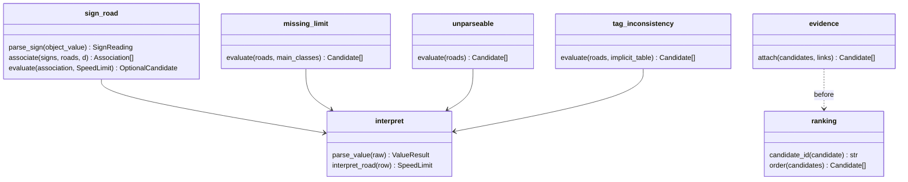
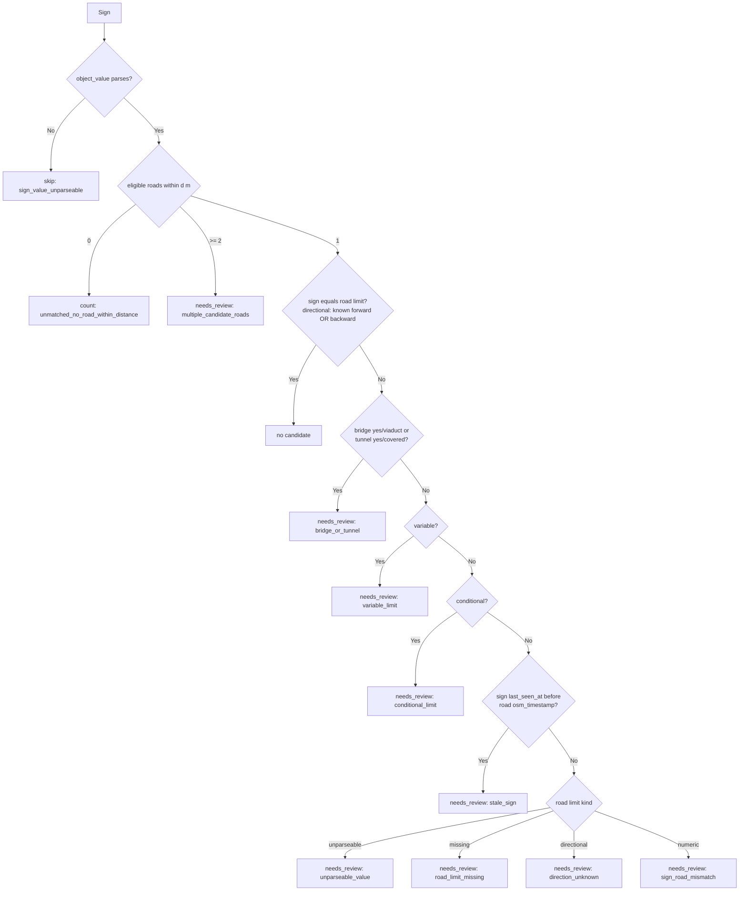
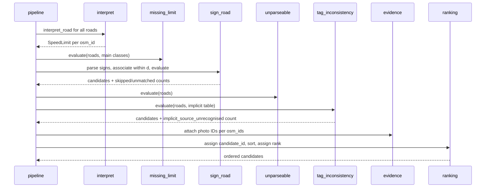

# ADR-002: Detection Rules — Interpretation, Checks, Ranking, Identifiers

**Date:** 2026-11-12
**Status:** Accepted (revised 2026-11-12 after the data profile `reports/map-qa/profile.md`)
**Relates to:** [`docs/ADR/000-main-architecture.md`](000-main-architecture.md), PRD AC-06–AC-09, AC-12–AC-17b, AC-18–AC-22, PRD §11, `mvp-scope.md` §1.1, §1.3, §1.5, §2 items 3–7

**Revision 2026-11-12:** level rule limited to real bridges/tunnels; one-sided directional limits defined as unknown; new reason `stale_sign`; new check `tag_inconsistency`; implicit table extended with `PL:zone<N>` and allowed-value sets; fixtures for `PL:*` now come from real rows.

---

## 1. Scope

Covers: interpretation of OSM speed-limit tags, parsing of Mapillary sign values, sign-to-road association, the four Stage 1 checks (`missing_limit`, `sign_road`, `unparseable_value`, `tag_inconsistency`), reason codes and explanations, photo evidence, ranking and stable candidate identifiers.

Does not cover: reading inputs (ADR-001), serialisation (ADR-000 §6.2), the OSM vs Overture check (deferred, AC-10/AC-11), model readings (Phase 2), verdicts.

All rules in this ADR are **pure functions over the frames of `InputBundle`**. They perform no I/O and are unit-tested without files beyond fixtures.

---

## 2. Technology Documentation References

| Library | Context7 ID or official docs | Used for |
|---|---|---|
| GeoPandas 1.2.0 spatial joins | https://geopandas.org/en/stable/docs/user_guide/mergingdata.html#spatial-joins | Sign-to-road candidates within distance (`sjoin` with `dwithin` predicate, or `sindex.query` with `predicate="dwithin"`) |
| Shapely STRtree | https://shapely.readthedocs.io/en/stable/strtree.html | Spatial index behind the join, `dwithin` predicate |
| Python `re` | https://docs.python.org/3.12/library/re.html | Value parsing |
| OSM Key:maxspeed | https://wiki.openstreetmap.org/wiki/Key:maxspeed | Value syntax, directional and conditional keys |
| OSM default speed limits — Poland | https://wiki.openstreetmap.org/wiki/Default_speed_limits#Poland | Implicit `PL:*` mapping |
| Polish traffic law (Prawo o ruchu drogowym, art. 20) | https://isap.sejm.gov.pl/isap.nsf/DocDetails.xsp?id=WDU19970980602 | Legal basis of the implicit values |

No Context7 IDs: Context7 MCP was unavailable (see ADR-000 §2). The implementing agent verifies the exact `dwithin` API of the installed GeoPandas/Shapely before use.

---

## 3. Speed-limit interpretation (`interpret.py`)

### 3.1 Single value → km/h

Applied to each of `maxspeed`, `maxspeed_forward`, `maxspeed_backward` independently. Input is the raw string; leading/trailing whitespace is ignored for matching only (the raw value is stored unchanged).

| Raw pattern | Result | Flags |
|---|---|---|
| null (tag absent) | absent | — |
| integer 1–200, no unit (e.g. `50`) | that number | — |
| integer followed by optional space and `mph` (e.g. `30 mph`) | round half up of n × 1.609344 | `converted_from_mph` |
| exact key in the implicit table (§3.2) | mapped number | `implicit` |
| anything else (`none`, `walk`, `signals`, `50;70`, `50 km/h`, `PL:expressway`, free text, integer 0 or > 200) | unparseable | — |

An unparseable value is never converted to a number and never treated as "no limit" (AC-09).

### 3.2 Implicit Polish values (AC-08, AC-17a)

One table serves two purposes: the **interpretation value** turns an implicit `maxspeed*` value into km/h (§3.1); the **allowed values** are used only by the `tag_inconsistency` check (§6.4).

| Category | Interpretation value (km/h) | Allowed values for §6.4 (km/h) | Basis |
|---|---|---|---|
| `PL:urban` | 50 | {50} | built-up area |
| `PL:rural` | 90 | {90, 100} | outside built-up area; 100 on dual carriageways with ≥ 2 lanes per direction |
| `PL:expressway` | — (unparseable: depends on carriageway type) | {100, 120} | expressway, single / dual carriageway |
| `PL:motorway` | 140 | {140} | motorway |
| `PL:living_street` | 20 | {20} | living street (strefa zamieszkania) |
| `PL:zone<N>` (e.g. `PL:zone30`) | N | {N} | speed zone |

Any other value (`sign`, `survey`, `PL:sign`, `PL:zone`, `zone30`, `PL;zone40`, `PL:zone30;sign`, `PL:trunk`) is not a category: it is not interpreted and not evaluated by §6.4. On the pinned snapshot `PL:urban` occurs in `maxspeed:forward`/`:backward` on 5 ways (profile §7), so the interpretation column is exercised by real data. The table is printed in `summary.md`. PRD open question 2 remains open for legal confirmation of these values.

### 3.3 Road → `SpeedLimit`

Evaluated in this order:

1. `variable` = (`maxspeed_variable` is not null and not `no`). `conditional` = (`maxspeed_conditional` is not null).
2. If `maxspeed_forward` or `maxspeed_backward` is present → **directional**: `forward_kmh` = interpretation of `maxspeed_forward` if present, otherwise of `maxspeed`; `backward_kmh` likewise. If a direction has neither its own tag nor `maxspeed`, its value is **unknown** (null) — never "no limit" (58 ways on the pinned snapshot have a limit in one direction only). If any present directional value or the fallback `maxspeed` is unparseable → kind **unparseable**.
3. Else if `maxspeed` is present → **numeric** with `value_kmh`, or **unparseable**.
4. Else → **missing**.

`raw` always holds the original strings of `maxspeed`, `maxspeed_forward`, `maxspeed_backward`, `maxspeed_conditional`, `maxspeed_variable`, `source_maxspeed`, `maxspeed_type` (AC-06). The `oneway` tag does not change interpretation in Stage 1.

### 3.4 Another level (bridge or tunnel)

`on_other_level` = `bridge` ∈ {`yes`, `viaduct`} **or** `tunnel` ∈ {`yes`, `covered`}. `tunnel=building_passage` (605 of 827 `tunnel` tags on the pinned snapshot), `bridge=culvert`, `bridge=boardwalk` and `layer` alone do **not** make a road another level: a passage under a building is at street level and would otherwise flood the queue with false `needs_review` items.

---

## 4. Sign value parsing

`object_value` must fully match `regulatory--maximum-speed-limit-<N>--g<k>` with N an integer 5–140. Otherwise the sign is skipped with reason `sign_value_unparseable` and counted (0 on the pinned snapshot). Signs are Mapillary detections: shown as "working reference" (PRD §11). `first_seen_at` and `last_seen_at` are parsed as UTC timestamps; `last_seen_at` is used by the `stale_sign` rule (§6.2), both dates are shown as evidence. Two signs may share an identical position, even with different values (2 pairs on the pinned snapshot); each sign is evaluated on its own and gets its own candidate ID.

---

## 5. Sign-to-road association

- **Eligible roads:** all roads whose `highway` is not in `checks.association_excluded_classes` (default `service`).
- **Distance:** planar distance in EPSG:2180 between the sign point and the road line. A road is a candidate when distance ≤ `checks.sign_road_distance_m` (default 20.0 m, inclusive).
- **Outcome per sign:** 0 candidates → skipped as `unmatched_no_road_within_distance` (AC-17, counted, no candidate); 1 candidate → single-road rules (§6.2); ≥ 2 candidates → `multiple_candidate_roads` (§6.2).
- **Never used:** photo camera heading (AC-18), sign facing (absent in the data), "nearest road" as proof of applicability (PRD §11).
- Distances are rounded to 0.1 m only when written; comparisons use full precision.

---

## 6. Checks

### 6.1 Check 1 — `missing_limit` (AC-15)

For every road with `highway` in `checks.main_road_classes` whose `SpeedLimit.kind` is **missing**:

| Condition | State | Reason code |
|---|---|---|
| `variable` | `needs_review` | `variable_limit` |
| `conditional` (and not variable) | `needs_review` | `conditional_limit` |
| otherwise | `conflict` | `missing_limit` |

Roads with directional tags are not **missing** (§3.3) and therefore not candidates, matching the profiling query (expected ≈ 290).

### 6.2 Check 2 — `sign_road` (AC-12–AC-14, `mvp-scope.md` §2 item 5)

**Two or more candidate roads:** always `needs_review`, reason `multiple_candidate_roads` (AC-13). `osm_ids` lists all candidate roads ordered by distance then `osm_id`; the `osm_*` value columns, `road_class`, `osm_version`, `osm_timestamp` describe the nearest road; `distance_m` is the nearest distance; `diff_kmh` is null.

**Exactly one candidate road R:**

1. Compute `match`: numeric R → sign value = `value_kmh`; directional R → sign value equals `forward_kmh` **or** `backward_kmh` (an unknown direction never matches). If `match` → **no candidate** (AC-14).
2. Otherwise the first matching row below applies:

| Order | Condition on R / sign | State | Reason code |
|---|---|---|---|
| 1 | R `on_other_level` (§3.4) | `needs_review` | `bridge_or_tunnel` |
| 2 | `variable` | `needs_review` | `variable_limit` |
| 3 | `conditional` | `needs_review` | `conditional_limit` |
| 4 | sign `last_seen_at` < R `osm_timestamp` (AC-17b) | `needs_review` | `stale_sign` |
| 5 | kind unparseable | `needs_review` | `unparseable_value` |
| 6 | kind missing | `needs_review` | `road_limit_missing` |
| 7 | kind directional | `needs_review` | `direction_unknown` |
| 8 | kind numeric | `needs_review` | `sign_road_mismatch` |

`stale_sign` comes after the structural reasons (level, variable, conditional), because those explain a difference regardless of dates, and before the value-based reasons, because a sign observed before the latest map edit cannot contradict that edit. Expected on the pinned snapshot: 191 of the 240 single-road signs that do not match.

`diff_kmh`: numeric → |sign − value|; directional → minimum over the known directions; otherwise null.

**No `sign_road` candidate is ever `conflict` in Stage 1** (`mvp-scope.md` §1.3). Promotion requires the manual precision sample.

### 6.3 Check 3 — `unparseable_value` (AC-16)

Every road (any class) whose `SpeedLimit.kind` is **unparseable** → one candidate, state `needs_review`, reason `unparseable_value`, with all raw values. Expected count on the pinned snapshot: 0 (`mvp-scope.md` §1.1); covered by fixtures.

### 6.4 Check 4 — `tag_inconsistency` (AC-17a)

For every road (any class) with a numeric `maxspeed` (kind numeric, value from the plain `maxspeed` tag):

1. For each of `source_maxspeed` and `maxspeed_type` that is a **category** in §3.2, test whether `value_kmh` is in its allowed values.
2. If at least one present category does not allow the value → one candidate, state `conflict`, reason `implicit_source_mismatch`. `osm_value_raw` holds `maxspeed`; the explanation names the tag(s), the category and its allowed values.
3. Values that are not categories are counted in `RunCounts.skipped` as `implicit_source_unrecognised` (once per road), not evaluated.

Not evaluated in Stage 1: directional variants (`source:maxspeed:forward`/`:backward`, `maxspeed:type:forward`/`:backward`), roads without a plain `maxspeed` (1,450 roads carry only an implicit source — they are informative, not contradictory), and disagreement between `source:maxspeed` and `maxspeed:type` themselves (5 roads; shown as evidence). Expected on the pinned snapshot: 161 roads, 102 of them on main roads.

`diff_kmh` (used for ranking, AC-19) = the smallest absolute difference between `maxspeed` and any allowed value of the violated categories (e.g. `PL:urban` + 70 → 20). Added during implementation, 2026-11-12. `implicit_source_unrecognised` counts roads whose source value is not a category (2,384 on the pinned snapshot, mostly `sign`).

### 6.5 Reason codes and explanations

Explanations are fixed English templates; placeholders are filled from the candidate. Wording never says "error" (PRD §11).

| Reason code | Explanation template |
|---|---|
| `missing_limit` | "Main road ({highway}) has no speed-limit value in OSM." |
| `sign_road_mismatch` | "Sign shows {sign} km/h; the only road within {d} m has {osm} km/h in OSM." |
| `direction_unknown` | "Sign shows {sign} km/h; the road has direction-specific limits {fwd}/{bwd} km/h and the sign's direction is unknown." |
| `multiple_candidate_roads` | "{n} roads lie within {d} m of the sign; it is unclear which one it governs." |
| `bridge_or_tunnel` | "Sign shows {sign} km/h; the only road within {d} m is a bridge or tunnel and may be on another level." |
| `variable_limit` | "Road has a variable speed limit (maxspeed:variable)." |
| `conditional_limit` | "Road has a conditional speed limit (maxspeed:conditional)." |
| `road_limit_missing` | "Sign shows {sign} km/h; the only road within {d} m has no speed-limit value in OSM." |
| `unparseable_value` | "OSM speed-limit value '{raw}' cannot be interpreted." |
| `stale_sign` | "Sign shows {sign} km/h but was last seen on {last_seen}, before the road was last edited in OSM on {osm_edit}." |
| `implicit_source_mismatch` | "OSM {tag}={category} allows {allowed} km/h, but maxspeed is {osm} km/h." |

---

## 7. Evidence, ranking, identifiers

### 7.1 Photo evidence (AC-22, partial)

For a candidate's `osm_ids`, select rows of `photo_road_links` with `osm_way_id` in that set, keep the minimum `distance_m` per `photo_id`, order by distance ascending then `photo_id`. Write `photo_count` and `photo_ids`. Capture date, author and licence per photo are available in `photos.csv` by `photo_id`; including them in the queue and thumbnails is deferred with the UI. Zero links → `photo_count` 0 and empty `photo_ids` ("no photos linked" appears in `summary.md`). Photo headings are not read.

### 7.2 Stable identifiers (AC-20)

Readable keys built only from the candidate type and source object identifiers:

| Type | Format | Example |
|---|---|---|
| `missing_limit` | `missing_limit:w<osm_id>` | `missing_limit:w4567890` |
| `unparseable_value` | `unparseable_value:w<osm_id>` | `unparseable_value:w4567890` |
| `tag_inconsistency` | `tag_inconsistency:w<osm_id>` | `tag_inconsistency:w4567890` |
| `sign_road`, one road | `sign_road:mly<sign_id>:w<osm_id>` | `sign_road:mly637795060500589:w123456` |
| `sign_road`, several roads | `sign_road:mly<sign_id>:w<id1>+w<id2>…` with `osm_id` ascending | `sign_road:mly637795060500589:w111+w222` |

IDs contain no versions, dates, distances or row positions. If the set of candidate roads changes in a newer snapshot, the ID changes; this is intended (the situation changed) and is handled by orphan reporting when verdicts arrive.

### 7.3 Ranking (AC-19)

Sort key, ascending: (class rank, `diff_kmh` is null, −`diff_kmh`, `candidate_id`). Class rank from `road_class`: motorway/motorway_link 0, trunk/trunk_link 1, primary/primary_link 2, secondary/secondary_link 3, tertiary/tertiary_link 4, anything else 5. `rank` is the 1-based position after sorting.

---

## 8. Diagrams

### Component diagram

### Sign vs road decision

### Sequence — checks inside the pipeline

---

## 9. Testing Strategy

### Fixture selection

The implementing agent builds fixtures with DuckDB queries against the pinned files and records each selected `osm_id` / sign `id` with its selection query in `app/tests/fixtures/README.md`. Required real rows: a road with plain numeric `maxspeed`; a road with `maxspeed:forward`/`:backward`; a motorway with `maxspeed:conditional`; a road with `maxspeed:variable=yes`; a main road without any limit; a `bridge=yes` road; a `tunnel=building_passage` road; a one-sided directional road (e.g. `maxspeed:forward` only, no `maxspeed`); a road with `PL:urban` in `maxspeed:forward`/`:backward` (one of `osm_id` 907138970, 1362930293, 1446272667, 1491960205, 1491960207); a road with `source:maxspeed=PL:urban` and `maxspeed=70`; a road with `source:maxspeed=PL:rural` and `maxspeed=100` (allowed); a road with `source:maxspeed=sign`; a sign with exactly one eligible road within 20 m and an equal value; one with a different value and `last_seen_at` after the road edit; one with a different value and `last_seen_at` before it; one with ≥ 2 roads; one with only a `service` road nearby. Synthetic rows (marked) only for cases absent from the snapshot: `mph`, `PL:expressway` in `maxspeed`, `50;70`, `none`, a sign at exactly 20.0 m.

### Test scenarios (six unit cases, `mvp-scope.md` §4)

| # | Scenario | Type | Input | Expected output | Edge cases |
|---|---|---|---|---|---|
| 1 | Interpretation | Unit, parametrised | raw tag sets from fixtures | `SpeedLimit` kind, km/h values and flags per §3; `raw` identical to input | `30 mph` → 48; `PL:urban` in `maxspeed:backward` → 50 implicit; `PL:zone30` → 30; `PL:expressway`, `50;70`, `none`, `0`, `250` → unparseable; whitespace ` 50 ` → 50 with raw kept; forward-only road → backward unknown |
| 2 | Directional comparison | Unit | one-road association, forward 50 / backward 70 | sign 70 → none; sign 40 → `direction_unknown`, `diff_kmh` 10 | forward-only 40, sign 50 → `direction_unknown` (unknown direction never matches) |
| 3 | Association | Unit | sign + fixture roads in EPSG:2180 | 1 road → single-road rules; 2 roads → `multiple_candidate_roads`; only `service` → unmatched | distance exactly 20.0 m is inside; 20.01 m outside; assertion fails if CRS ≠ EPSG:2180 |
| 4 | Precedence of uncertain reasons | Unit, parametrised | single road with bridge + conditional + old sign + different value | `bridge_or_tunnel`; then `variable_limit`, `conditional_limit`, `stale_sign`, `road_limit_missing` in order | equal value on a bridge → no candidate; `building_passage` → not `bridge_or_tunnel`; sign seen after the edit → `sign_road_mismatch` |
| 5 | Road-level checks | Unit, parametrised | main roads, a tertiary road, roads with implicit sources | missing main road → `conflict`/`missing_limit`; tertiary → none; directional → none; `PL:urban`+70 → `conflict`/`implicit_source_mismatch`; `PL:rural`+100 → none; `sign` → none, counted `implicit_source_unrecognised` | `motorway_link` included; `PL:zone40`+30 → candidate |
| 6 | Ranking and IDs | Unit | candidates in shuffled order | order by class rank, then diff desc with nulls last, then ID; IDs match §7.2 | multiple roads: `osm_id` ascending in ID regardless of distance order |

### Technical acceptance criteria

- **TAC-002-01** Every candidate's `reason_code` is one of the eleven codes in §6.5 and its `explanation` contains none of the words "error", "wrong", "incorrect".
- **TAC-002-02** No `sign_road` candidate has state `conflict`.
- **TAC-002-03** For every candidate, `candidate_id` is unique within the run and reproducible from `type`, `sign_id` and `osm_ids` alone.
- **TAC-002-04** On the pinned snapshot (measured 2026-11-12, `reports/map-qa/profile.md`): `missing_limit` candidates (all states) 250–330 (measured 290); `unparseable_value` 0; `tag_inconsistency` 140–180 (measured 161); signs with exactly one eligible road within 20 m 380–460 (measured 420); `stale_sign` 170–210 (measured 191); `bridge_or_tunnel` among single-road signs ≤ 10 (measured 2). Out-of-range counts are investigated, not "fixed" by changing the range.
- **TAC-002-05** `photo_ids` for every candidate are ordered by link distance ascending and `photo_count` equals their number.

### Not applicable in Stage 1

The `mvp-scope.md` §4 case "heading 359/1" concerns bearing wrap-around when computing photo-to-road links. Stage 1 uses the precomputed `photo_road_links.csv` and never reads headings (AC-18), so the case moves to the `public_api` source where links are computed.

---

## 10. Open questions

1. When ≥ 2 roads are within the distance and **all** of them have a limit equal to the sign value, should the `multiple_candidate_roads` candidate be suppressed? Stage 1 follows AC-13 literally (always a candidate); suppression would shrink the queue considerably and needs a PRD change.
2. Confirm the implicit-value table (§3.2), including the allowed sets {90, 100} for `PL:rural` and {100, 120} for `PL:expressway` — PRD open question 2.
3. `road_limit_missing` on non-main roads (sign shows a value, road has none) — keep as `needs_review` or count only? Stage 1 keeps it as a candidate (78 single-road signs on the pinned snapshot sit on roads without a limit).
4. `stale_sign` uses the road's last edit of **any** tag (`osm_timestamp`), not of `maxspeed` specifically; OSM history is not in the snapshot. A road re-edited for an unrelated tag makes an older sign stale. Revisit if `check_date:maxspeed` (79 ways) or history becomes available.
