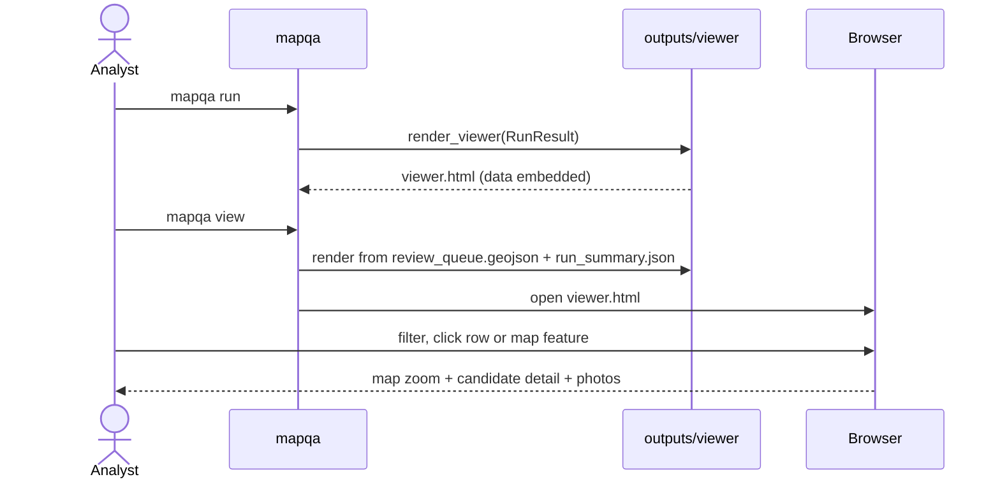

# ADR-003: Read-only Result Viewer

**Date:** 2026-11-12
**Status:** Accepted
**Relates to:** [`docs/ADR/000-main-architecture.md`](000-main-architecture.md) (amends D4), PRD §9.1–9.4, AC-21, AC-22, AC-25 (filters type/state/class), AC-28, `mvp-scope.md` §2 item 8a

---

## 1. Scope

A single self-contained HTML page, `viewer.html`, generated by the CLI into the output folder next to `review_queue.*`. The analyst opens it in Chrome or Edge to browse candidates on a map and in a table and to inspect evidence. Decided with the user on 2026-11-12: local, part of `app/`, English UI.

Not covered: recording verdicts (AC-23, AC-24), review-status filter, a server, authentication, mobile layout.

---

## 2. Technology Documentation References

| Library | Context7 ID or official docs | Used for |
|---|---|---|
| Leaflet 1.9.4 (from `unpkg.com/leaflet@1.9.4`) | https://leafletjs.com/reference.html | Map, GeoJSON layers, popups, fit bounds |
| Esri World Light Gray Canvas (default), Esri World Imagery | https://server.arcgisonline.com/ArcGIS/rest/services/Canvas/World_Light_Gray_Base/MapServer | Calm grey default basemap so candidate colours stand out; satellite option. No key required (verified 2026-11-12) |
| OpenStreetMap standard tiles (colour and CSS-greyscale variants) | https://operations.osmfoundation.org/policies/tiles/ | Optional basemaps; attribution required, low volume only; may be blocked for `file://` pages without Referer |
| Python `json`, `html`, `string.Template` | https://docs.python.org/3.12/library/string.html#template-strings | Generating the page |
| Playwright for Python (msedge channel) | https://playwright.dev/python/docs/browsers#google-chrome--microsoft-edge | Manual QA screenshots (dev tool, not a runtime dependency) |

No Context7 IDs (Context7 unavailable, see ADR-000 §2).

**Basemaps (revised 2026-11-12 after user feedback "hard to see / no access to the basemap"):** a layer switcher offers Light grey (Esri, default), OpenStreetMap (grey), OpenStreetMap, Satellite (Esri) and No basemap; after 4 tile failures the viewer switches to the next basemap and says so on the map. CARTO was rejected: it now returns HTTP 200 with an "API KEY REQUIRED" image, which no fallback can detect. Data attribution (OSM, Overture, Mapillary) is a fixed part of the attribution control, independent of the basemap. Conflicts are drawn above review points; the selected candidate has a yellow halo.

---

## 3. Component Design

| Part | Responsibility |
|---|---|
| `outputs/viewer.py` | Builds the page from the in-memory `RunResult` (during `mapqa run`) or from existing `review_queue.geojson` + `run_summary.json` (during `mapqa view`). Pure function `render_viewer(data) -> str` plus a thin writer. |
| `outputs/viewer_template.html` | Static template (HTML + CSS + vanilla JS) with one placeholder for the embedded data. Packaged inside `mapqa`. |
| `cli` | New subcommand `mapqa view [--output-dir PATH] [--no-open]`: regenerates `viewer.html` from the files in the output folder and opens it in the default browser unless `--no-open`. |

`mapqa run` writes `viewer.html` as part of the atomic output set (ADR-000 D5).

### Data embedded in the page

One JSON object inside `` from data | note text containing `</script>` |
| `view` without results | Integration (CLI) | empty output folder | exit 3, "No run results found — run the pipeline first" | — |
| `run` writes viewer | Integration | real snapshot | `viewer.html` exists; embedded candidate count equals `review_queue.csv` rows | — |
| Manual QA | Playwright (msedge) | real run | screenshots: initial page, filtered table, selected candidate detail; no console errors | filter with no results shows the empty message |

### Technical acceptance criteria

- **TAC-003-01** `viewer.html` opens from `file://` in Edge with no console errors (except tile requests when offline).
- **TAC-003-02** The number of rows shown with all filters at "All" equals the number of rows in `review_queue.csv`.
- **TAC-003-03** Attribution text is visible on the map at every zoom level.
- **TAC-003-04** UI text is English and never says "error" about a candidate.
