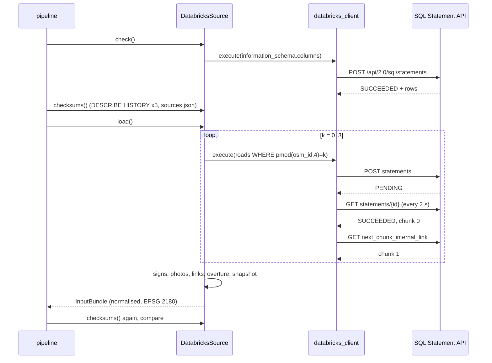

# ADR-004: Databricks Source (Stage 2)

**Date:** 2026-11-13
**Status:** Accepted
**Relates to:** [`000-main-architecture.md`](000-main-architecture.md), [`001-data-sources-and-config.md`](001-data-sources-and-config.md) §3.3, §4, §4.5, [`003-viewer.md`](003-viewer.md), PRD AC-05a–AC-05f, `mvp-scope.md` §2 items 9–10

---

## 1. Scope

The `databricks` value of `source.kind`: a read-only adapter for the five `workspace.map_qa` tables that returns the same `InputBundle` as `FilesSource`, so `mapqa run --source databricks` produces a review queue byte-identical to `--source files` on the pinned snapshot. Also: `check-source --source databricks`, integrity fingerprints for remote inputs, and how the viewer avoids reading local files in a Databricks run.

Not covered: `public_api`, writing to Databricks, Databricks MCP, `EXTERNAL_LINKS`.

## 2. Evidence (captured 2026-11-13, `app/tests/fixtures/databricks/`)

All decisions below rest on real SQL Statement Execution API 2.0 responses (captures are redacted and token-checked; `capture.py` reproduces them).

| Measurement | Result |
|---|---|
| Full projected `osm_roads`, `INLINE` + `JSON_ARRAY` | `SUCCEEDED`, 99,768 rows in 5 chunks, 25.4 MB, 17 s — **97 % of the 25 MiB `INLINE` limit** |
| Same projection, `pmod(osm_id, 4) = 0` | 24,910 rows, 2 chunks, 6.3 MB |
| Values in `JSON_ARRAY` | every value is a JSON string or null; `ARRAY` columns arrive as a JSON text (`'["…","…"]'`) |
| Types differing from the files | `photo_road_links.osm_way_id` INT (files BIGINT); `traffic_signs.first_seen_at/last_seen_at` STRING `2024-07-05T16:58:57+0000`; `photos.captured_at` TIMESTAMP; geometry BINARY; extra `_rescued_data` column |
| Tag extraction | `get_json_object(tags, "$['maxspeed:forward']")` works |
| Errors | missing table → HTTP 200, `status.state = FAILED`, `error.error_code = BAD_REQUEST`; malformed auth header → HTTP 400 `text/plain` (seen with a broken token) |
| Async | `wait_timeout = 0s` → `PENDING` with only `statement_id`, `status`; `GET …/statements/{id}` → `SUCCEEDED` |
| Snapshot file | `read_files('/Volumes/workspace/map_qa/inputs/sources.json', format => 'text', wholeText => true)` returns the same `sources.json` |
| Table version | `DESCRIBE HISTORY workspace.map_qa.osm_roads LIMIT 1` → `version` 1 (rows also carry user id/name — never stored) |
| Column check | `workspace.information_schema.columns` returns all 86 columns in one statement |

## 3. Component Design

| Part | Responsibility |
|---|---|
| `sources/databricks_client.py` | Minimal REST client on `urllib` (no new dependency): `execute(statement) -> Result` submits, polls the same `statement_id`, follows `next_chunk_internal_link`, checks `manifest.total_row_count`, and converts values by `manifest.schema` type. Only statements whose first keyword is `SELECT` or `DESCRIBE` are accepted (read-only guard, AC-05e). |
| `sources/databricks.py` (`DatabricksSource`) | Fixed statement templates per table, partitioned roads read, snapshot from the volume, fingerprints, `check()` via `information_schema`. Builds frames with the shared normalisers. |
| `sources/normalise.py` | Shared by both adapters: `roads_frame`, `signs_frame`, `photos_frame`, `links_frame`, `overture_frame` take plain columns + WKB bytes and return the exact `InputBundle` dtypes, CRS (EPSG:2180) and sort order. Parity is structural: both adapters end in the same functions. |

`FilesSource` is refactored to produce WKB for signs too (DuckDB `ST_Read` + `ST_AsWKB`) and to call the same normalisers.

## 4. Data Contracts

**Statements** (schema from `source.databricks.schema`, default `workspace.map_qa`):
- roads: projection of ADR-001 §4.3 columns + six `get_json_object` tag columns + `base64(geometry)`, read in **4 partitions** `WHERE pmod(osm_id, 4) = k`, concatenated and sorted by `osm_id` locally;
- signs: `id, object_value, first_seen_at, last_seen_at, image_ids, source_url, base64(geometry)`;
- photos / photo_road_links: the columns of ADR-001 §4.3 (no `SELECT *`, so `_rescued_data` never appears);
- overture: `id, class`;
- snapshot: `read_files(<volume>/sources.json)` where `<volume>` = `/Volumes/<catalog>/<schema>/inputs`;
- fingerprint: `DESCRIBE HISTORY <table> LIMIT 1` → `version` only.

**Type conversion** (by `manifest.schema.columns[].type_name`): `LONG`, `INT`, `SHORT`, `BYTE` → Python `int`; `DOUBLE`, `FLOAT`, `DECIMAL` → `float`; `BOOLEAN` → `bool` from `"true"/"false"`; `STRING`, `TIMESTAMP`, `DATE` → `str` (timestamps parsed to UTC by the normalisers, exactly like the files path); `ARRAY`, `STRUCT`, `MAP` → `json.loads`; JSON `null` → `None`. An unknown type is a source error naming the column.

**Integrity (TAC-04 for a remote source):** `checksums()` returns per-input fingerprints: `delta-version:<n>` for the five tables, `sha256:<hex>` of the `sources.json` text. The pipeline compares before/after exactly as for files. `run_summary.json` `inputs.<name>` gets `fingerprint_before/after` for every source; `sha256_before/after` stay present for files and are `null` for Databricks tables.

## 5. Interface Contracts

| Situation | Behaviour | Exit |
|---|---|---|
| `DATABRICKS_TOKEN` absent, or host / warehouse unresolved (TOML → `DATABRICKS_HOST` / `DATABRICKS_SQL_WAREHOUSE_ID`, ADR-001 §3.3) | `SourceUnavailable("databricks: missing <NAME>")` — presence only, never the value | 4 |
| HTTP 401 / 403 | "databricks: credentials rejected (HTTP <code>)" | 4 |
| HTTP 400 non-JSON | "databricks: request rejected (HTTP 400) — check the token format and host" | 4 |
| other HTTP error, `URLError`, timeout | "databricks: <step>: unreachable (<class>)" | 4 |
| `FAILED` / `CANCELED` / `CLOSED` | "databricks: <step>: statement <state>: <error_code> <message>"; never treated as empty | 4 |
| rows read ≠ `total_row_count` | "databricks: <step>: read <n> of <m> rows" | 4 |
| required column missing (`information_schema`) | `InputError` naming table and column | 3 |

Polling: submit with `wait_timeout = 30s`, `on_wait_timeout = CONTINUE`; poll the same `statement_id` every 2 s; client deadline 300 s per statement (a stopped warehouse may take a minute to wake). No automatic retries, no re-submit, no fallback to files (AC-05d). Error texts never contain request headers or the token.

`check-source --source databricks` resolves settings, runs the `information_schema` statement and reports one `ok` / problem line per table plus `snapshot`.

## 6. Technical Decisions

### Partitioned INLINE reads
**Status:** Accepted · **Date:** 2026-11-13
**Context:** the full roads projection fits `INLINE` today but at 97 % of the 25 MiB limit.
**Decision:** `INLINE` + `JSON_ARRAY`, roads in 4 `pmod(osm_id, 4)` partitions (~6.3 MB each); other tables in one statement.
**Rejected alternatives:**
- Single INLINE statement: breaks with ~3 % data growth.
- `EXTERNAL_LINKS` + Arrow: pre-signed cloud-storage URLs (egress from the VM untested), more code and a second download path.
**Consequences:** (+) 4× headroom, same code path for all tables, fixtures cover it; (−) 4 roads statements instead of 1.
**Review trigger:** one partition exceeds 15 MB, or the warehouse quota limits concurrent statements.

### Shared normalisers for parity
**Status:** Accepted · **Date:** 2026-11-13
**Context:** AC-05b requires byte-identical queues; the two sources deliver different types.
**Decision:** both adapters convert to plain values + WKB and pass through `sources/normalise.py`.
**Rejected alternatives:** per-adapter conversion with a parity test only (drift found late).
**Consequences:** (+) one place defines dtypes; (−) `FilesSource` refactor.
**Review trigger:** a third source (`public_api`).

### Remote fingerprints instead of checksums
**Status:** Accepted · **Date:** 2026-11-13
**Context:** files are hashed before/after (AC-01); remote tables cannot be hashed cheaply.
**Decision:** Delta table version before/after; SHA-256 of the volume `sources.json`.
**Consequences:** (+) detects a table rewrite during the run at negligible cost; (−) not a content hash.
**Review trigger:** tables stop being Delta.

### Viewer context written by `run`
**Status:** Accepted · **Date:** 2026-11-13 (amends ADR-003 §3)
**Context:** `mapqa view` re-read `osm_roads.parquet` and `photos.csv` from the data folder; after a Databricks run that mixes sources (PRD §7).
**Decision:** `run` writes `viewer_context.json` (road geometries for sign candidates + photo metadata) next to the outputs, built from the active `InputBundle`; `view` rebuilds the page only from the output folder. Offline thumbnails (`<data_dir>/offline`) belong to the files snapshot and are used only when `source.kind = files`; a Databricks run shows "Photo unavailable offline" with the source link.
**Consequences:** (+) no source mixing, `view` works without the data folder; (−) one more output file.

## 7. Diagrams

## 8. Testing Strategy

| Scenario | Type | Input | Expected |
|---|---|---|---|
| Polling + chunks | Unit | replay of `poll_sequence.json`, `osm_projection_full_inline.json` | same `statement_id` polled; every `next_chunk_internal_link` requested in order; row-count check |
| Type conversion | Unit | `osm_projection_sample.json`, `signs_sample.json` | ints, nulls, JSON arrays, strings as specified |
| Errors | Unit | `failed_missing_table.json`, HTTP 401/400 stubs | `SourceUnavailable` with state/code; token sentinel absent from the message |
| Read-only guard | Unit | `DROP TABLE …` | rejected before any request |
| Normalisers | Unit | sample rows from both sources | identical dtypes and values |
| Parity | Integration, marker `databricks` (skipped with reason when variables are missing) | real warehouse | row counts = files; `review_queue.csv`/`.geojson` byte-identical; wrong token → exit 4, no leak |

### Technical acceptance criteria
- **TAC-004-01** `mapqa run --source databricks` exits 0 and its `review_queue.csv` and `review_queue.geojson` are byte-identical to the files run on the pinned snapshot.
- **TAC-004-02** No request other than `SELECT`/`DESCRIBE` statements and their result reads is sent.
- **TAC-004-03** The token value never appears in stdout, stderr, outputs or fixtures (sentinel test).
- **TAC-004-04** `run_summary.json` records source `databricks`, schema, read time, row counts and fingerprints (AC-05f).
- **TAC-004-05** `mapqa view` after a Databricks run reads nothing from the local data folder.
