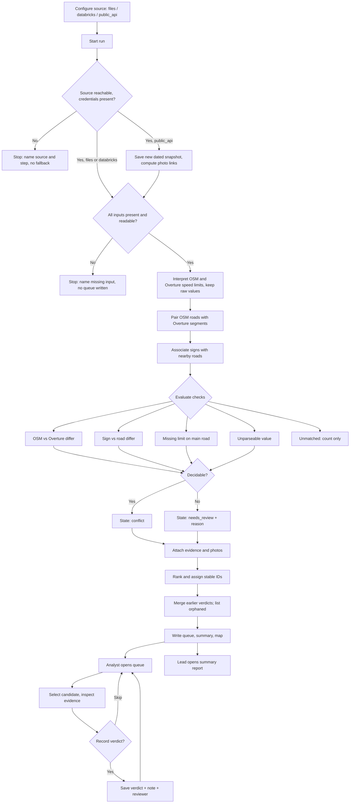
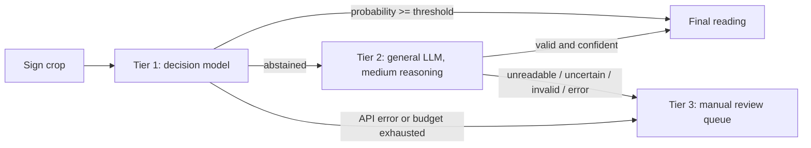

# PRD — Speed-Limit Conflict Finder (Kraków) — Prototype A

---

## 1. Executive Summary

A prototype (MVP) that compares speed-limit information for roads in Kraków and its surroundings across OpenStreetMap (OSM), Overture Maps and Mapillary traffic-sign detections, and produces a ranked queue of candidate speed-limit problems for manual review. Map QA analysts review each candidate with its evidence (values from each source, nearby signs and street-level photos) and record a verdict; team leads get a summary report. The prototype finds candidates for a human to check — it never decides on its own that the map is wrong.

---

## 2. Problem Statement

Speed limits in open map data are incomplete and inconsistent: OSM and Overture can disagree for the same road, signs observed in street-level imagery can show a different value than the map, main roads may have no limit at all, and many OSM values are free text that cannot be interpreted reliably (units, multiple values, conditional or direction-specific limits, implicit values such as `PL:urban`).

Today an analyst has to open several sources by hand, find the matching road in each, look for nearby signs and photos, and decide whether there is a problem — with no list of where to start and no record of what was already checked. There is no shared, repeatable way to say how many problems exist, which ones matter most, and which have been reviewed.

---

## 3. Users / Personas

**Ola — Map QA analyst.** Reviews map data quality daily. Wants to open a queue of the most important candidates, see for each one what every source says and why it was flagged, look at the nearest photos and the sign position on a map, and record a verdict with a short note. Expects that verdicts survive the next run and that the queue does not show already-reviewed items as new.

**Piotr — Data team lead.** Plans QA work and reports on data quality. Wants aggregate numbers: how many candidates of each type, on which road classes, how many reviewed, how many confirmed. Expects every number in the report to be reproducible from the input data and does not review individual items.

**Edge persona — Analyst reviewing an ambiguous case.** Sees a candidate where the sign may belong to a parallel carriageway or a slip road, or the limit applies only at certain times. Needs the candidate clearly marked as "needs review" with the reason, so it is not mistaken for a confirmed conflict.

---

## 4. Main Flows

### 4.1 Generate the review queue (happy path)

1. The user selects the data source for the run in the configuration — local files, Databricks tables or public APIs — and starts the run.
2. The system checks that the selected source is reachable and that credentials it needs are present (without displaying them), then reads the OSM roads, the Overture road segments, the Mapillary speed-limit sign objects, the photo manifest and the photo-to-road links from that source. Inputs are never modified.
3. The system interprets every OSM speed-limit value and every Overture speed-limit rule, keeping the original raw value alongside the interpreted value.
4. The system pairs OSM roads with Overture segments describing the same road. *(Deferred — OSM vs Overture check, `mvp-scope.md` §1.2.)*
5. The system associates each speed-limit sign with candidate roads near the sign's position.
6. The system evaluates the checks in scope for the current stage (Section 6, AC-10 to AC-17b; scope per stage in `mvp-scope.md` §2) and assigns each candidate a state: `conflict` or `needs_review`, with a machine-readable reason code and a human-readable explanation.
7. The system attaches evidence to each candidate: values and raw tags from each source, distances, sign value and dates, and all photos linked to that road, nearest first.
8. The system orders candidates (road importance, then size of the difference) and assigns each a stable identifier.
9. The system merges in any verdicts recorded in earlier runs (matched by candidate identifier).
10. The system writes the review queue, the summary report and the map view, and prints run totals.

### 4.2 Review a candidate and record a verdict (analyst)

1. Ola opens the review view and sees the queue, unreviewed candidates first, in ranked order.
2. She selects a candidate; the map centres on the road, showing the road geometry, matched segment, related signs and photo positions.
3. She reads the evidence panel: each source's value (interpreted and raw), the reason the candidate was flagged, and photo thumbnails.
4. She records a verdict: `confirmed_problem`, `not_a_problem` or `unsure`, with an optional note.
5. The system saves the verdict with a timestamp and the reviewer name.
6. On the next run, the candidate keeps its verdict and is shown as reviewed.

### 4.3 Read the summary (team lead)

1. Piotr opens the summary report.
2. He sees totals per conflict type and per state, broken down by road class, plus counts of reviewed / confirmed / rejected / unsure.
3. He sees the input snapshot identification (source dates/release) and the counts of records skipped and why.

### 4.4 Alternative paths

- **Ambiguous case:** a check cannot be decided reliably (conditional or time-based limit, direction-specific tags with unknown camera direction, sign near two parallel roads, bridge/tunnel above or below, value cannot be interpreted). The candidate gets state `needs_review` with the specific reason; it is never counted as a confirmed conflict or as "OK".
- **No match:** an OSM road has no matching Overture segment, or a sign has no road within the distance limit. This is recorded as a data state and counted in the report; it is not a conflict.
- **Candidate disappears:** a candidate that had a verdict is no longer produced by a new run (e.g. after a data refresh). Its verdict is kept and reported as "orphaned", not deleted.
- **Missing photo file:** a linked photo is not available locally. The candidate is still shown; the photo slot states that the photo is unavailable.
- **Invalid input:** a required input is missing or unreadable. The run stops with a message naming the missing input; no partial output is presented as complete.
- **Remote source unavailable:** Databricks or a public API cannot be reached, rejects the credentials, or a query fails. The run stops with a message naming the source and the failed step; it does not switch to another source on its own. The user changes the configuration and re-runs.

---

## 5. User Stories

1. As a QA analyst, I want a ranked list of speed-limit candidates with the most important roads first, so that I spend review time where errors matter most.
2. As a QA analyst, I want to see the value from each source, both interpreted and raw, so that I can tell a real disagreement from an interpretation problem.
3. As a QA analyst, I want to see the nearest photos and the sign position on a map, so that I can check the situation on the ground without opening other tools.
4. As a QA analyst, I want to record a verdict and a note for each candidate and have it kept across runs, so that I never review the same item twice.
5. As a team lead, I want to run the same checks on local files, on the shared Databricks tables or on fresh public-API data by changing only the configuration, so that the team can work offline, on the shared warehouse, or on current data.
6. As a QA analyst, I want ambiguous cases clearly separated with the reason, so that I do not treat a time-dependent or direction-dependent limit as a confirmed error.
7. As a team lead, I want totals per conflict type, state and road class, so that I can plan QA effort and report progress.
8. As a team lead, I want every number to be reproducible from the input snapshot, so that I can trust and defend the report.
9. As any user, when an input file is missing or unreadable, I want the run to stop with a clear message, so that I never act on an incomplete queue.

---

## 6. Acceptance Criteria

**Scope by stage** (details: `mvp-scope.md` §2, design: `docs/ADR/`):

| ACs | Stage |
|---|---|
| AC-01–AC-09, AC-12–AC-17b, AC-19–AC-21, AC-26, AC-27 | Stage 1 (built) |
| AC-22, AC-25 (type/state/class filters), AC-28 | Stage 1 via the read-only viewer (ADR-003); photo metadata partly |
| AC-05a–AC-05f (Databricks part) | Stage 2 |
| AC-10, AC-11 (OSM vs Overture) | Deferred |
| AC-05g, AC-05h (public API), AC-05i, AC-23, AC-24, AC-25 review status, AC-25a–AC-25c | Deferred |
| AC-29–AC-40 | Phase 2 / Stage 3 |

### Inputs and run
- **AC-01** A run never modifies, moves or deletes any input file; input checksums before and after a run are identical.
- **AC-02** If any required input is missing or unreadable, the run exits with a non-zero status and a message naming the input; no review queue is written.
- **AC-03** Two runs on the same inputs and the same configuration produce identical review queues (same candidates, identifiers, states and order).
- **AC-04** Every run prints and stores: number of OSM roads, Overture segments, signs and photos read; number of candidates per type and state; number of records skipped per reason.
- **AC-05** All distances are computed in metres in a metric projection suitable for Poland; no distance is computed in degrees.

### Data sources (configurable)
- **AC-05a** The data source is chosen in configuration, without code changes, as exactly one of: `files` (local snapshot), `databricks` (the five shared `map_qa` tables), `public_api` (Overture public bucket, OSM extract download, Mapillary and Panoramax APIs). One run reads all datasets from the one selected source.
- **AC-05b** For the same pinned snapshot, a run on `files` and a run on `databricks` produce identical row counts per dataset and an identical review queue (same candidates, identifiers, states and order).
- **AC-05c** Before reading, the run checks that the source is reachable and that every credential it needs is present; it never prints, logs or stores credential values, and never asks for them inside an agent conversation.
- **AC-05d** If the selected source is unreachable, rejects the credentials, or a query ends in a failed or cancelled state, the run exits with a non-zero status and a message naming the source and step; it never falls back to another source automatically and never treats a failed query as an empty result.
- **AC-05e** Access to Databricks and the public APIs is read-only: the system issues only read queries and never creates, modifies or deletes tables, schemas or remote resources.
- **AC-05f** The report and the review queue state the source used, the source location (file folder, Databricks schema, or API endpoints and release), the read time, and row counts per dataset.
- **AC-05g** A `public_api` run first saves the data it read as a new, dated snapshot (with release/extract dates and checksums) and then runs the checks on that snapshot; photo-to-road links are computed by the system, not taken from the pinned links file. It never overwrites the pinned snapshot.
- **AC-05h** A `public_api` run reads only the configured area (default bbox above) and stays within configured request limits; it never downloads a global dataset.
- **AC-05i** Verdicts are attached to candidates from a different snapshot only when the candidate identifier matches; the report shows how many verdicts were carried over between snapshots and how many became orphaned.

### Interpreting speed-limit values
- **AC-06** For every OSM road, the raw speed-limit tags (including direction-specific and conditional variants) are preserved unchanged next to the interpreted value.
- **AC-07** A plain numeric value (e.g. `50`) is interpreted as that number in km/h; a value with `mph` is converted to km/h and marked as converted.
- **AC-08** Implicit Polish values (e.g. `PL:urban`, `PL:rural`, `PL:motorway`) are interpreted according to a documented mapping table, and the candidate shows that the value is implicit.
- **AC-09** A value that cannot be interpreted (free text, multiple conflicting numbers, unknown format) is never converted to a number and never silently treated as "no limit".

### Conflict detection
- **AC-10** *OSM vs Overture:* for a matched OSM–Overture pair where both have an unconditional limit for the same direction and the values differ, a `conflict` candidate is created showing both values and the difference in km/h.
- **AC-11** *OSM vs Overture:* if either side's limit is conditional (time, vehicle type, part of segment) or direction-specific and the directions cannot be aligned, the candidate is `needs_review` with the corresponding reason.
- **AC-12** *Sign vs road:* a sign associated with exactly one road within the distance limit, whose value differs from that road's interpreted limit, creates a `needs_review` candidate (reason `sign_road_mismatch`, or a more specific reason per ADR-002 §6.2) showing the sign value, sign dates and distance. *(Revised 2026-11-12: never `conflict` until the manual precision sample justifies promotion — `mvp-scope.md` §2, Deferred.)*
- **AC-13** *Sign vs road:* a sign with two or more candidate roads within the distance limit (parallel carriageway, slip road, bridge/tunnel) creates a `needs_review` candidate listing all candidate roads.
- **AC-14** A sign value that matches the road's limit creates no candidate.
- **AC-15** *Missing limit:* every OSM road of class motorway, trunk, primary or secondary (including their link roads) with no speed-limit value at all creates a `conflict` candidate of type "missing limit".
- **AC-16** *Unparseable value:* every OSM road whose speed-limit value cannot be interpreted (AC-09) creates a candidate of type "unparseable value" showing the raw value.
- **AC-17** A road or sign with no match in the other source is counted in the report as "unmatched" and creates no conflict candidate.
- **AC-17a** *Tag inconsistency:* every OSM road whose `source:maxspeed` or `maxspeed:type` names a Polish implicit limit category (`PL:urban`, `PL:rural`, `PL:expressway`, `PL:motorway`, `PL:living_street`, `PL:zone<N>`) and whose numeric `maxspeed` is outside the values allowed for that category in a documented table creates a `conflict` candidate of type "tag inconsistency" showing both tags and the allowed values. Unrecognised source values (e.g. `sign`, `survey`, `zone30` without `PL:`) are not evaluated and are counted in the report.
- **AC-17b** *Stale sign:* a sign associated with exactly one road whose value differs from that road's limit and whose `last_seen_at` is earlier than the road's last OSM edit (`osm_timestamp`) creates a `needs_review` candidate with reason `stale_sign`, never `conflict`; the candidate shows both dates.
- **AC-18** The camera heading of a photo is never used as the direction of travel.

### Ranking and identification
- **AC-19** Candidates are ordered by road class (motorway, trunk, primary, secondary, tertiary, other), then by absolute difference in km/h descending (candidates without a numeric difference last within their class), then by identifier.
- **AC-20** Each candidate has an identifier derived only from its type and the source object identifiers; the same input situation produces the same identifier in every run.

### Evidence
- **AC-21** Each candidate shows: type, state, reason code and explanation, road class, every source's interpreted and raw value, and the source object identifiers.
- **AC-22** Each candidate shows all photos linked to the road, nearest first, each with capture date, author, licence and distance; the number of linked photos is shown; if none are linked, it states "no photos linked".

### Review and verdicts
- **AC-23** The user can record exactly one of `confirmed_problem`, `not_a_problem`, `unsure` per candidate, with an optional note of up to 500 characters; the verdict is stored with timestamp and reviewer name.
- **AC-24** After a re-run, every verdict whose candidate identifier still exists is shown on that candidate; verdicts whose candidate no longer exists are listed as "orphaned" in the report and are not deleted.
- **AC-25** The queue can be filtered by type, state, road class and review status (unreviewed / reviewed).

### Uncertain results
- **AC-25a** Candidates in state `needs_review`, candidates with verdict `unsure`, and (Phase 2) model abstentions are shown in a separate "Uncertain" section of the queue, each with its reason.
- **AC-25b** Uncertain items are counted separately in the report and are never included in confirmed-problem totals, "OK" totals or accuracy figures.
- **AC-25c** A candidate with verdict `unsure` remains open: it stays in the Uncertain section and can receive a second verdict; the report shows how many `unsure` items await a second review.

### Report
- **AC-26** The summary report shows counts per type × state, per road class, and per verdict, and every count equals the number of matching rows in the review queue.
- **AC-27** The report shows the snapshot identification of each source (extract date / release) and the attribution and licence for OSM, Overture, Mapillary and Panoramax.
- **AC-28** Any map view displays "© OpenStreetMap contributors" and the other source attributions at all times.

### Phase 2 — Model reading of sign crops
Phase 2 starts only after the MVP acceptance criteria pass. It uses the sign photo set (real sign crops with working reference labels).

- **AC-29** The model receives only a neutral question text and the image crop. File names, photo identifiers, reference labels, Mapillary values and OSM/Overture attributes are never sent to the model.
- **AC-30** The model's answer is one of: a speed value in km/h of a round B-33 speed-limit sign, `none` (no such sign in the crop, including zone and end-of-limit signs), or `unreadable`, together with a probability.
- **AC-31** A hard limit of **25 model calls per run** applies to both model tiers combined, counting the first call, failed calls and errors. When the limit is reached, no further calls are made; items not yet resolved go to the manual review queue with reason `budget_exhausted`, and the report states their number.
- **AC-32** There are no automatic retries. Each call has a 40-second timeout. After the first API error, the paid loop stops; the error is recorded as `model_unavailable`, never as a reading.
- **AC-33** Before the first paid call, the system shows the sample manifest (which crops, how many calls) and waits for explicit user confirmation.
- **AC-34** Results are cached: re-running on the same crop and question makes no new call and does not count against the limit.
- **AC-35** If the decision model's highest probability is below a threshold, its result is `abstained` (system decision), distinct from the model answering `unreadable` (model output). The threshold is fixed before the final evaluation and shown in the report.
- **AC-35a** *Escalation tier 2:* every crop where the decision model `abstained` is sent once to a general-purpose LLM with vision and a medium reasoning level, with the same neutral question, the same image crop and the same answer options (value, `none`, `unreadable`). No information from the first tier (its answer or probabilities) is passed to the second tier.
- **AC-35b** The tier-2 answer is accepted only if it is exactly one of the allowed answer options and the model does not mark itself as uncertain; an answer outside the allowed options, `unreadable`, an explicit uncertainty statement, a timeout or an API error counts as "unresolved".
- **AC-35c** *Escalation tier 3 (human):* every crop unresolved after tier 2 is added to the manual review queue (the "Uncertain" section, AC-25a) with reason `model_unresolved`, showing both tiers' outputs; the system never fills in a value for it.
- **AC-35d** Each reading records which tier produced the final result: `decision_model`, `general_llm` or `human`. Accepted tier-1 results are never sent to tier 2.
- **AC-35e** The report shows, per tier: number of items received, resolved and passed on, and accuracy over `certain` reference labels with explicit denominators; plus end-to-end accuracy and the share of items that reached the human queue.
- **AC-36** Each call is recorded with status, response and timing, with no secrets in any stored record.
- **AC-37** Reference labels are read only by the evaluation step, never by the reading step.
- **AC-38** The report shows accuracy before and after abstention, coverage, and the number of abstentions, computed only over items whose reference label status is `certain`, with explicit denominators (e.g. "14 / 18 certain items"). Empty or uncertain labels are never counted as `none`.
- **AC-39** Evaluation samples are split by photo sequence, not by neighbouring frames.
- **AC-40** A model reading that differs from the road's limit creates at most a `needs_review` candidate (never `conflict`), with the model value, probability and the note "model output, not verified".

---

## 7. Out of Scope

- **AI / model reading of signs in the MVP** — specified as Phase 2 (AC-29 to AC-40); the MVP uses only deterministic rules and existing Mapillary detections. Model reading of anything other than the speed value of round B-33 signs is out of scope in both phases.
- **Editing OSM or Overture** — the tool never uploads or proposes edits to any map source.
- **Automatic verdicts** — the system never marks a candidate as a confirmed map error.
- **Areas outside the Kraków area** — the configured area may be narrowed, but other cities are not supported or tested in the MVP.
- **Mixing sources in one run** — e.g. roads from Databricks and photos from files.
- **Automatic fallback between sources.**
- **Writing to Databricks** — results are not written back as tables.
- **Scheduled or continuous refresh** — `public_api` runs are started manually.
- **Other attributes** — surface, lanes, sidewalks, lighting, road class correctness.
- **Travel-time or routing impact** of a wrong limit.
- **Authentication, user accounts, roles** — reviewer name is typed in, not verified.
- **Multi-user concurrent review**, notifications, admin UI.
- **Multilingual UI** — English only.
- **Mobile layout** — desktop browser only.

---

## 8. Constraints

### Business
- Data licences must be respected: OSM and Overture (ODbL 1.0), Mapillary and Panoramax photos (CC BY-SA 4.0), Mapillary-derived metadata (ODbL 1.0). Attribution appears in every report, map and export.
- No company or private data is used; only the public snapshot provided for the course.
- Access tokens (Databricks SQL token, Mapillary token) are set by the user in the environment; they are never written to files, logs, reports or the repository, and never pasted into an agent conversation.
- The shared Databricks workspace is read-only for this product; only read queries are allowed, even if the token's permissions are broader. Reading may start a stopped SQL warehouse, which uses the shared budget.
- Public API terms and rate limits apply (Mapillary, Panoramax, Overture bucket, OSM extract provider). Live data may differ from the pinned snapshot.

### Functional
- Area: Kraków and surroundings, WGS84 bbox 19.80, 49.95, 20.15, 50.15. Roads crossing the bbox are kept whole.
- Scale of the snapshot: ~99,800 OSM roads, ~85,400 Overture segments, ~1,730 speed-limit sign objects, 561 photos. A full run must complete on a standard training VM (Windows, no Docker/WSL).
- Speed limits are in km/h in all outputs.
- The sign-to-road distance limit is a single configurable value, shown in the report.
- Reference labels and Mapillary detections are working references, not ground truth, and are never presented as such.
- Desktop browser, latest Chrome or Edge.

### External document / data references

| Document / data | Location | When it is used |
|---|---|---|
| Data description and caveats | `course-materials/exercise-data/map-qa/README.md` | Defining matching and interpretation rules |
| Source dates, filters, matching rules, hashes | `course-materials/exercise-data/map-qa/sources.json` | Snapshot identification in the report |
| OSM roads | `course-materials/exercise-data/map-qa/osm_roads.parquet` | Road geometry, class, speed-limit tags |
| Overture road segments | `course-materials/exercise-data/map-qa/overture_segments.parquet` | Second source of speed limits |
| Mapillary speed-limit signs | `course-materials/exercise-data/map-qa/traffic_signs.geojson` | Sign vs road checks |
| Photo manifest and links | `course-materials/exercise-data/map-qa/photos.csv`, `photo_road_links.csv` | Evidence photos per candidate |
| Offline photos | `course-materials/exercise-data/map-qa/offline/` | Thumbnails without network access |
| Licences and attribution | `course-materials/exercise-data/map-qa/ATTRIBUTION.md` | Attribution text in outputs |
| Databricks access and table list | `course-materials/exercise-data/map-qa/DATABRICKS.md` | `databricks` source: tables `workspace.map_qa.osm_roads`, `overture_segments`, `photos`, `photo_road_links`, `traffic_signs` |
| Refresh and download scripts | `course-materials/exercise-data/map-qa/refresh_sources.py`, `refresh_mapillary_urls.py`, `download_photos.py` | Reference behaviour for the `public_api` source |
| Sign photo set (crops, manifest, working labels, nearest OSM road) | `course-materials/exercise-data/map-qa/signs/` | Phase 2 model reading and evaluation only; labels read by the evaluator only |

---

## 9. UI Description (wireframe level)

The delivery form (generated static report vs. small local dashboard) is decided in the ADR. Both must provide the screens below; if a static report is chosen, verdict recording must still meet AC-23 and AC-24.

**Decision 2026-11-12 (ADR-003):** Stage 1 delivers a **read-only static viewer** — a single HTML page generated by the CLI next to the review queue, opened in Chrome/Edge — covering 9.1 Summary, 9.2 Review queue (filters type, state, road class) and 9.3 Candidate detail without the verdict form. UI text is English. Verdict recording (AC-23–AC-25 review status) stays deferred.

### 9.1 Summary
- Header with snapshot identification and run date.
- Table of counts: type × state; second table by road class; third table by verdict.
- Counts of unmatched and skipped records with reasons.
- Link to the review queue.
- Attribution footer.

### 9.2 Review queue
- Left: filterable, sortable table — rank, type, state, road class, OSM value, Overture value, sign value, difference, review status.
- Right: map with all candidates in the current filter, coloured by state; clicking a marker selects the row.
- Filters: type, state, road class, review status. Empty result shows "No candidates match the filters".
- Attribution always visible on the map.

### 9.3 Candidate detail
- Map zoomed to the road: OSM geometry, matched Overture segment, related signs, photo positions with view direction.
- Evidence panel: reason explanation, each source's interpreted and raw value, identifiers, distances, sign dates.
- Photo strip: all linked photos as a scrollable row of thumbnails, nearest first, with count ("12 photos"), date, author, licence and distance; click opens the full image; missing photo shows "Photo unavailable".
- Phase 2: model reading result for related sign crops (value, probability, or "abstained" with reason), clearly labelled as a model output.
- Verdict form: three options, note field (max 500 characters, counter shown), reviewer name, Save. After saving: confirmation and "reviewed" badge. Saving without a selected option shows "Select a verdict".
- Previous / Next buttons follow the current queue order.

### 9.4 Loading and error states
- While data loads: "Loading candidates…".
- If the queue file is missing: "No run results found — run the pipeline first".

---

## 10. User Flow Diagram

---

## 11. Agent / System Behavior Specification

No AI model is used in the MVP. In Phase 2 sign reading uses a three-tier escalation (AC-29 to AC-40):

1. **Decision model** reads the speed value of a round B-33 sign from the crop and returns a probability distribution. If its highest probability is at or above the threshold, its answer is final.
2. **General LLM (medium reasoning)** receives the same neutral question and crop when tier 1 abstained. A valid, confident answer is final.
3. **Human** — anything still unresolved goes to the manual review queue with both models' outputs.

Both models may answer only a value, `none` or `unreadable`; they may not decide whether the map is wrong, see any map attributes, labels or the other tier's answer, or be called beyond the 25-call limit. Abstention is a system decision based on probability; API errors are errors, never answers.

The automated decision rules must follow these constraints:

- The system only flags candidates; it never states that a map is wrong. Wording in outputs uses "candidate", "disagreement", "needs review", never "error confirmed".
- The system must not treat: a camera heading as travel direction; the nearest road as proof that a sign applies to it; a missing tag as a value of zero or "no limit"; a difference between snapshots of different dates as an error by itself.
- When a rule cannot decide, the result is `needs_review` with one of a fixed set of reason codes (e.g. `conditional_limit`, `direction_unknown`, `multiple_candidate_roads`, `bridge_or_tunnel`, `stale_sign`, `unparseable_value`) and a one-sentence explanation.
- Reference labels and detector outputs are shown as "working reference", never as ground truth.

---

## 12. Further Notes

**Decisions made in the PRD interview (2026-11-03):**
- Users: both analyst and team lead.
- After a run: view results and record verdicts.
- UI form: static report or local dashboard — to be chosen in the ADR.
- All four conflict types are in the MVP. *(Superseded 2026-11-12: OSM vs Overture deferred — `mvp-scope.md` §1.2; tag inconsistency added — AC-17a.)*
- Ambiguous cases: separate `needs_review` state with reason.
- No AI in the MVP; model reading of sign crops specified as Phase 2.
- Phase 2 budget: max 25 model calls per run including errors, no retries, 40 s timeout.
- Data sources: configurable — local files, Databricks tables, public APIs; one source per run; on failure stop with a clear error (no automatic fallback).
- Phase 2 escalation: decision model → general LLM with medium reasoning (only when tier 1 abstains) → human manual queue (only when tier 2 is also unresolved).
- Photos: all linked photos are shown per candidate.
- Uncertain results (`needs_review`, `unsure`, abstentions): separate queue section and separate counts; `unsure` stays open for a second review.
- Ranking: road importance, then size of the difference.

**Decisions after the data profile and Databricks access check (2026-11-12, see `reports/map-qa/profile.md`):**
- New check in the MVP: tag inconsistency between `source:maxspeed` / `maxspeed:type` and `maxspeed` (AC-17a); ~161 ways in the pinned snapshot.
- Stale signs: a differing sign older than the road's last OSM edit is `needs_review` / `stale_sign` (AC-17b); ~80% of differing single-road signs in the pinned snapshot.
- Only `bridge` ∈ {`yes`, `viaduct`} and `tunnel` ∈ {`yes`, `covered`} count as another level; `building_passage`, `culvert`, `boardwalk` do not.
- A road with a limit in one direction only has an unknown limit in the other direction (never "no limit").
- Default sign-to-road distance: 20 m (open question 1 resolved in ADR).

**Open questions:**
1. ~~Default sign-to-road distance limit~~ — resolved: 20 m (ADR-002).
2. Mapping table for implicit Polish limits (`PL:urban` = 50, `PL:rural` = 90, etc.) — confirm values and source.
3. ~~How to treat a sign whose `last_seen_at` is older than the OSM edit date~~ — resolved: AC-17b.
4. Where verdicts are stored so they can be shared between two analysts later (out of scope now, but affects the storage choice).
5. Should `tertiary` roads also count for "missing limit" if the number of candidates stays manageable?
6. Phase 2: abstention threshold value and the probability source to use (to be set on a validation split before the final test).
7. Phase 2: who approves the budget before the first paid call (trainer allocation).
8. Phase 2: should the 25-call limit be split between tiers (e.g. a reserved number of tier-2 calls), or stay shared as now (AC-31)?
9. Phase 2: how the tier-2 LLM signals uncertainty — an explicit `uncertain` option, a self-reported confidence, or only `unreadable`? (General LLMs do not return calibrated probabilities; the ADR must define the rule used in AC-35b.)
10. `public_api` source: the APIs do not provide photo-to-road links, and Mapillary photo URLs expire. Confirm that recomputing links and refreshing URLs per run is acceptable, and which request limits to set.
11. Should the configuration also allow other warehouses later (e.g. PostGIS), or are the three sources enough for the course?

**Later stages (beyond Phase 2):** comparison of conflicts against photo-based reference labels, refresh to a newer snapshot with verdict carry-over.
